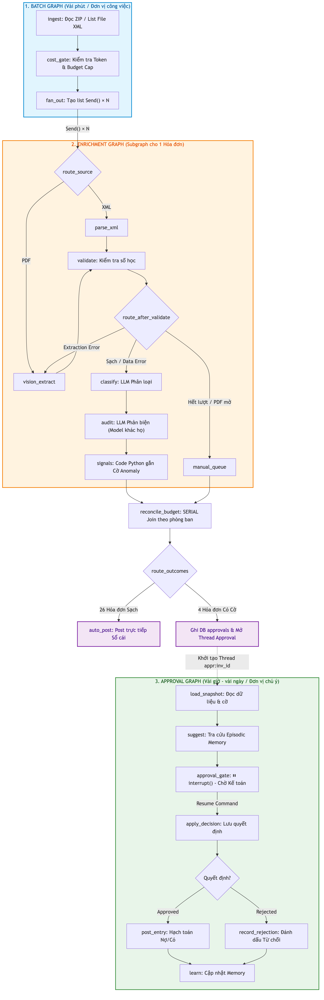

# 🧾 Vietnamese Invoice & Expense Agent

Agent xử lý hóa đơn điện tử Việt Nam (XML theo QĐ-1450 / NĐ 123/2020 sửa bởi NĐ 70/2025):
trích xuất → phân loại tài khoản kế toán TT133 → đối chiếu ngân sách → **người duyệt** → ghi bút toán.

> **Trạng thái: M0 (nền móng).** Chưa có pipeline chạy được. Kế hoạch đầy đủ ở
> [`docs/Plan_Project_F_2026-07-25.md`](docs/Plan_Project_F_2026-07-25.md), thiết kế hệ thống ở
> [`docs/project-f-system-design.md`](docs/project-f-system-design.md).

## Safety property — ba lớp độc lập

**LLM không bao giờ bật một cờ, không bao giờ post một bút toán.**

1. **Code** — cờ do Python deterministic tính từ sự thật trong DB; response model của agent
   không có field approval/flag/status nào (structured output *là* ranh giới an ninh).
2. **Database** — CHECK constraint từ chối bút toán lệch Nợ/Có; `audit_log` bị REVOKE UPDATE/DELETE.
3. **Test** — `test_never_post_without_approval.py` giữ cả hai lớp trên khỏi bị gỡ.

## Bắt đầu

```bash
make install      # uv venv + pip install -e ".[dev]"
make dev          # docker compose up -d postgres (pgvector)
make test         # pytest
make lint         # ruff + mypy
```

Yêu cầu: **Python 3.13** (3.9/3.10 không đủ), Docker, [uv](https://docs.astral.sh/uv/).

## Kiến trúc — ba graph, không phải một

| Graph | Việc | Vì sao tách |
|---|---|---|
| `enrichment_graph` | Một hóa đơn: parse → validate → classify → audit → signals | 5/8 node **không gọi LLM** — deterministic thì đừng để LLM làm |
| `batch_graph` | `Send` fan-out N hóa đơn + reconcile ngân sách **serial** | Thứ tự canonical ⇒ cùng một hóa đơn luôn là cái vượt ngân sách |
| `approval_graph` | HITL: `interrupt()` → người duyệt → post/reject → learn | Cắt thread tại ranh giới con người ⇒ batch không bị chặn bởi 4 hóa đơn chờ duyệt |



## Không có gì trong này

Supervisor agent · Redis · Qdrant · OCR riêng · Auth/multi-tenant · tích hợp ERP thật.
Mỗi cái đều có lý do được ghi lại — xem §4 của plan.

## Chi phí

≈ **$0.0005/hóa đơn** shadow cost (giá `gpt-4o-mini`), thực tế **$0** trên free tier.
Nhỏ như vậy vì 85% hóa đơn đi đường XML deterministic, không phải vì dùng model rẻ.
