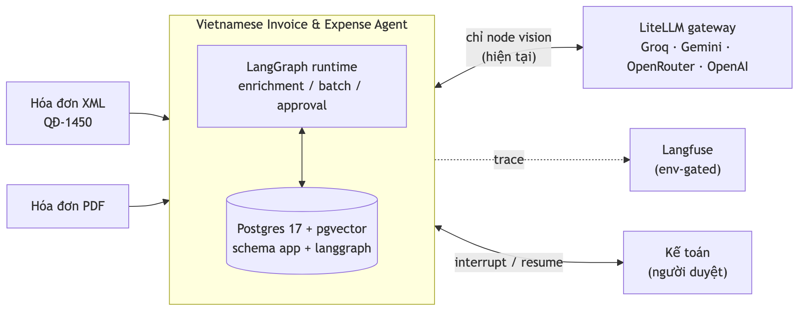
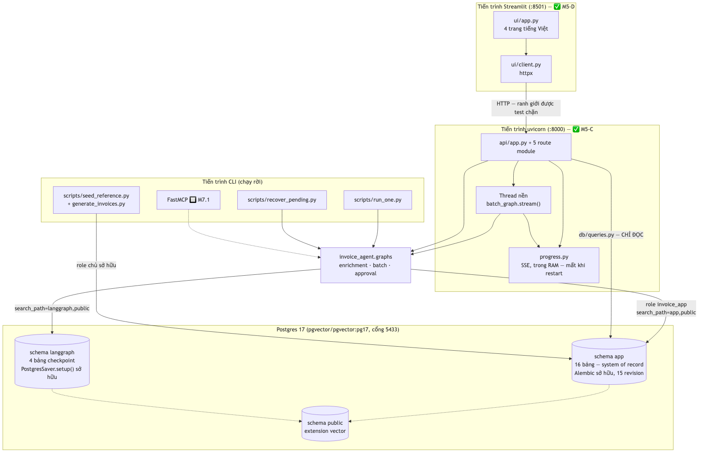
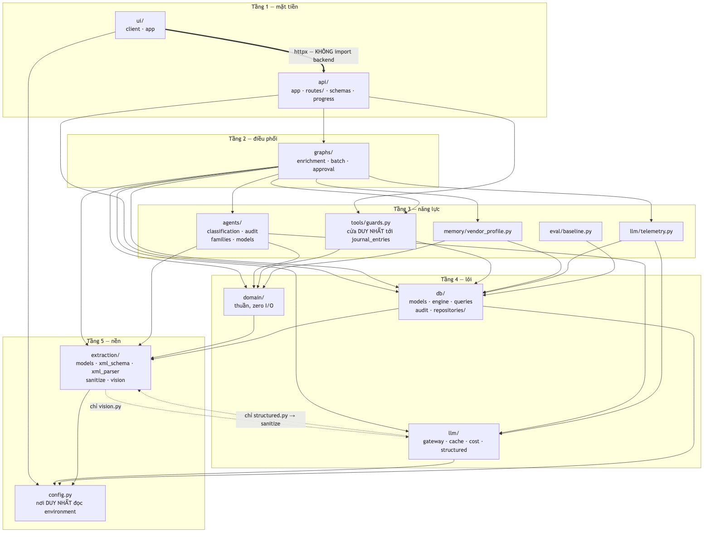
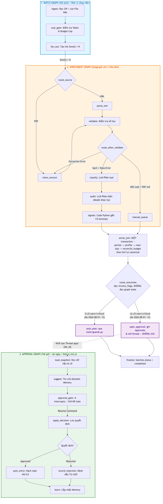
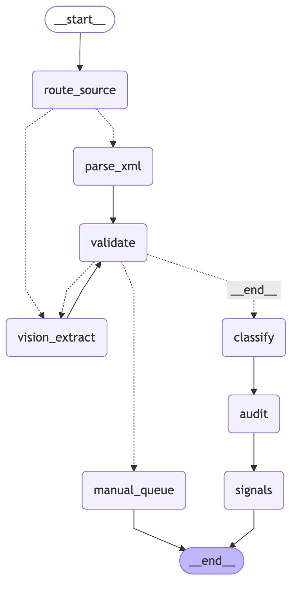
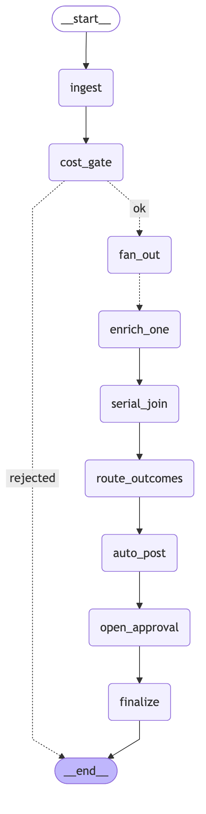
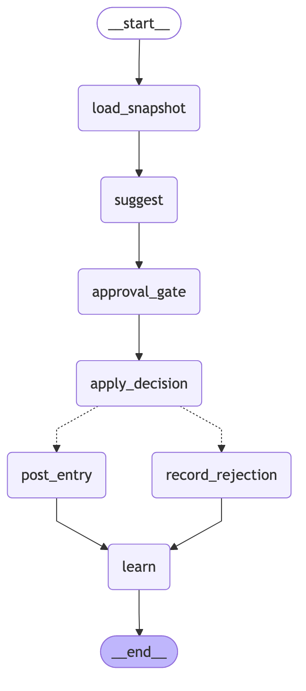
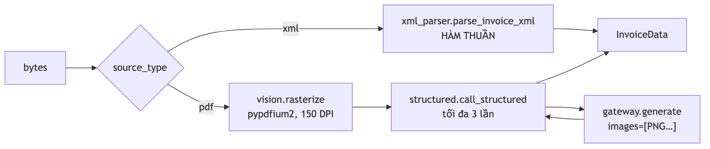
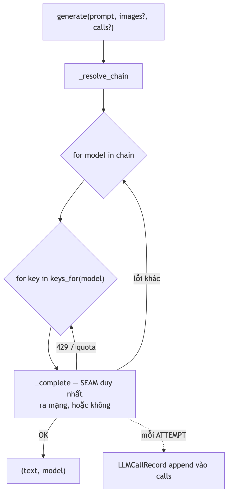
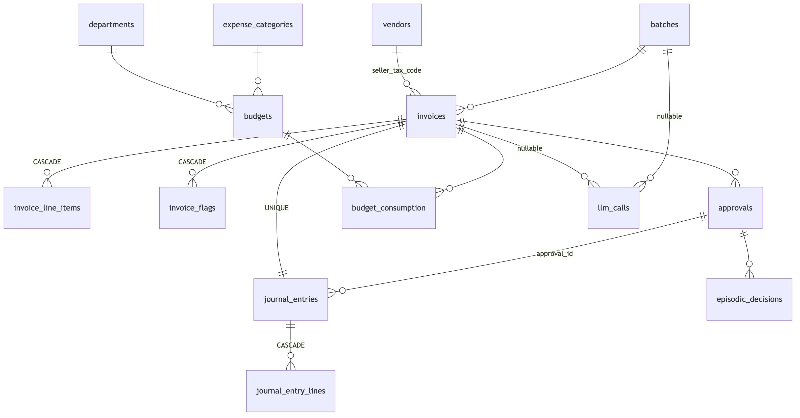

# Kiến trúc hệ thống — Vietnamese Invoice & Expense Agent

**Ngày viết**: 2026-07-29 · **Cập nhật**: 2026-08-01 (đóng M5) · **Phạm vi**: toàn bộ hệ thống
*hiện có trong repo*
**Trạng thái đo được**: Milestone M0–M5 đã đóng · `make check` **671 passed in 41.45s** (đo
2026-08-01, Postgres 17 local, `LLM_MODE=replay` + mọi API key bỏ trống — tức đúng cấu hình CI),
ruff sạch, mypy sạch trên 69 file nguồn

> **Tài liệu này mô tả cái ĐANG CÓ, không phải cái sẽ có.** Mọi thành phần chưa được viết đều
> được đánh dấu 🔲 kèm milestone sở hữu nó. Thiết kế đầy đủ (bao gồm phần chưa làm) nằm ở
> [`project-f-system-design.md`](project-f-system-design.md); lộ trình và gate nằm ở
> [`Plan_Project_F_2026-07-25.md`](Plan_Project_F_2026-07-25.md). Tài liệu này là **lát cắt kiến
> trúc của hiện tại**, và nó cố ý nói rõ chỗ nào hiện tại còn trống.

---

## 1. Tóm tắt điều hành

Hệ thống nhận hóa đơn điện tử Việt Nam (XML theo QĐ-1450 / NĐ 123/2020 sửa bởi NĐ 70/2025, hoặc PDF),
trích xuất dữ liệu, kiểm tra tính đúng đắn bằng luật deterministic, phân loại tài khoản kế toán
TT133, đối chiếu ngân sách, đưa hóa đơn có vấn đề cho **người duyệt**, rồi mới ghi bút toán.

Ba câu định hình toàn bộ kiến trúc:

1. **LLM không bao giờ bật một cờ, không bao giờ post một bút toán.** Cờ do Python thuần tính từ
   sự thật trong database. Ranh giới an ninh là **response model** — model không có *kênh* để tự
   cấp quyền, chứ không phải bị *thuyết phục* là không nên. Từ M5-A, đường duy nhất tới
   `journal_entries` là `tools/guards.py`, và guard **đọc lại Postgres** thay vì tin state.
2. **Ba graph, không phải một.** Một batch là đơn vị *công việc* (phút); một lần duyệt là đơn vị
   *sự chú ý của con người* (giờ/ngày). Trộn hai nhịp thời gian đó vào một thread thì hóa đơn
   sạch phải chờ hóa đơn đang treo ở `interrupt()`. Cả ba graph **đã tồn tại** từ M5-B, và
   `test_batch_not_blocked_by_pending.py` đo được điều đó: batch về `completed` trong khi 12
   approval vẫn chưa ai quyết định.
3. **Deterministic trước, LLM sau.** Trong `enrichment_graph` có **3/8 node** gọi LLM
   (`vision_extract`, `classify`, `audit`) — đúng tỉ lệ thiết kế đầy đủ dự kiến. Parse, số học,
   bật cờ, so hai ý kiến và quyết định post là việc máy tính phải làm **chính xác**, không phải
   việc LLM làm **xấp xỉ**.

Bốn con số M4/M5 đáng nhớ, tất cả đều đo được và một trong số đó là **kết quả âm**:

| Phép đo | Kết quả | Ghi chú |
|---|---|---|
| Phân loại danh mục | **95.4%** vs baseline `keywords_vi` **57.9%** | +37.5 điểm, gate đòi +15 |
| Phân loại phòng ban | **77.2%** | trần lý thuyết của corpus là **84.0%** |
| Auditor dispute precision | **12.5%** (CI 0.043–0.310, n=24) | **DƯỚI** ngưỡng net-harm 50% của §6.4 — thí nghiệm multi-agent cho kết quả âm và được báo cáo đúng như vậy |
| `PRICE_OUTLIER` | **0/6 → 6/6**, FP 0.7% | sau khi `signals` đọc profile *trước* khi hóa đơn được persist |

Chi phí thực tế ≈ **$0** (free tier), shadow cost ≈ **$0.0005/hóa đơn** theo giá `gpt-4o-mini` —
nhỏ vì ~85% hóa đơn đi đường XML deterministic, **không phải** vì dùng model rẻ.

---

## 2. Bối cảnh & phạm vi

| Hạng mục | Nội dung |
|---|---|
| **Người dùng** | Kế toán của một công ty thương mại ~40 người (kịch bản TT133, không phải TT200) |
| **Đầu vào** | XML QĐ-1450 (2 dạng root: `HDon` trần và `TDiep` bọc), PDF hóa đơn scan — qua CLI hoặc qua `POST /batches` từ Streamlit |
| **Đầu ra** | Bút toán Nợ/Có trong `journal_entries`, cờ cảnh báo, báo cáo ngân sách/cờ/hạch toán/chi phí, hàng chờ duyệt |
| **Ràng buộc cứng** | Hạ tầng $0 (free tier), một database Postgres duy nhất, Python 3.13 |
| **Ngôn ngữ sản phẩm** | Tiếng Việt (prompt, giải thích cờ, UI) — đây là **dữ liệu miền**, không phải văn phong |

**Cố tình KHÔNG làm** (quyết định đã chốt, xem plan §4): supervisor agent · Redis · Qdrant · OCR
tự viết · auth/multi-tenant · tích hợp ERP thật.

> **Không có auth, và đó là quyết định chứ không phải sót.** `DecisionRequest.decided_by` ghi lại
> cái client **tự khai**. UI nói thẳng điều đó trên màn hình ("Người duyệt (chưa có đăng nhập — tự
> khai)"). Một bản triển khai thật sẽ lấy giá trị đó từ session.

---

## 3. Năm nguyên tắc kiến trúc

### 3.1 Safety property — ba lớp độc lập

Không phải "ba lần kiểm tra cùng một thứ", mà **ba cơ chế khác họ nhau**, gỡ lớp này không làm hai
lớp kia yếu đi:

| Lớp | Cơ chế | Ở đâu |
|---|---|---|
| **Code** | `tools/guards.py` — cửa DUY NHẤT tới `journal_entries`; response model của agent/API **không có** field approval/flag/status | `tools/guards.py`, `agents/models.py`, `api/schemas.py` (`extra="forbid"`, `frozen=True`) |
| **Database** | `CHECK`, `UNIQUE`, `TRIGGER`, `REVOKE` | `migrations/versions/*`, `db/models.py` |
| **Test** | Mutation guard — phá luật thì test phải đỏ | `tests/test_never_post_without_approval.py`, `test_schema_constraints.py`, `test_agent_schema_boundary.py`, `test_api_boundary.py`, `test_ui_boundary.py` |

Cụ thể ở lớp database:

```sql
-- Một hóa đơn không thể post hai lần, kể cả khi node chạy lại sau kill -9
UNIQUE (invoice_id) ON journal_entries
-- Bút toán lệch Nợ/Có bị từ chối ở tầng lưu trữ
CHECK (total_debit = total_credit)
-- 'human_approved' không phải chỉ là một chuỗi ứng dụng ghi vào
CHECK (posting_authority <> 'human_approved' OR approval_id IS NOT NULL)
-- Còn cờ warn/critical mở thì cấm post tự động  (migration 13 thu hẹp từ "mọi cờ")
TRIGGER trg_forbid_auto_clean_with_open_flags BEFORE INSERT OR UPDATE ON journal_entries
-- audit_log append-only: privilege + trigger, vì superuser bỏ qua privilege
REVOKE UPDATE, DELETE ON app.audit_log FROM invoice_app
TRIGGER trg_audit_log_append_only BEFORE UPDATE OR DELETE ON app.audit_log
```

`invoice_flags.raised_by` có `CHECK (raised_by IN ('validation','taxcode','anomaly','budget',
'duplicate','vendor_memory','agent_disagreement'))` — danh sách này **là mã hóa DDL của nguyên tắc
"LLM không bật cờ"**. Thêm một nguồn vào đó đòi hỏi một migration, nên nó không thể xảy ra vô tình
trong một node — và đúng một lần điều đó đã xảy ra **có chủ đích**: migration 12 (`m4c_12_agent_
disagreement`) nới danh sách để nhận `agent_disagreement`. Ngay cả cờ đó cũng **không do model bật**:
`agents/classification.py::dispute()` là Python so sánh hai structured output và quyết định.

**Ba lớp cắn độc lập, đã đo.** `test_never_post_without_approval.py` được xác nhận **5/5 mutation
đỏ**, mỗi lớp một lý do khác nhau. Một chi tiết đáng nhớ: bỏ `UNIQUE(invoice_id)` **không** làm case
"post hai lần" đỏ, vì guard đọc entry cũ trước khi insert — phải gọi thẳng
`repositories.journal` (bỏ qua guard) mới thấy constraint cắn. Hai case đo hai thứ khác nhau, và
việc đó được ghi lại thay vì làm tròn thành "3 lớp đều đỏ".

### 3.2 Deterministic trước, LLM sau

`enrichment_graph` hiện tại: `route_source` (✗ LLM) → `parse_xml` (✗) → `vision_extract` (✓) →
`validate` (✗) → `classify` (✓) → `audit` (✓) → `signals` (✗) → `manual_queue` (✗). **3/8 node**
tiêu token, và cả ba đều chỉ *đề xuất*: `validate` và `signals` — hai node sinh ra cờ — không gọi
model nào.

Trong `batch_graph` và `approval_graph`: **zero LLM call**. `suggest` đặc biệt cố ý không gọi model
(§6.4), vì nó nằm trên đường mà batch phải chờ.

### 3.3 Structured output *là* ranh giới an ninh

Ba response model, cùng một luật:

| Model | Ở đâu | Cố ý THIẾU |
|---|---|---|
| `InvoiceData` | `extraction/models.py` | `category`, `department`, `status`, `classification_confidence`, mọi field cờ/duyệt |
| `ClassificationResult` / `AuditVerdict` | `agents/models.py` | mọi field approval/flag/status; `category`/`department` là `Literal`, không phải `str` |
| `DecisionRequest` | `api/schemas.py` | `posting_authority`, `approval_id`, `status`, `entry_id` |

`extra="forbid"` là nửa còn lại — thiếu nó thì một field lạ bị **bỏ qua im lặng**, và bản audit
danh sách field sẽ đang kiểm một schema mà request không thực sự bị ràng buộc theo.

**Vì sao `Literal` chứ không `str`** — một phép đo, không phải khẩu vị: 2026-08-01, một verdict
`gemini-3.5-flash` live đề xuất `OFFICE_REPAIR_MAINTENANCE`, một danh mục **không tồn tại**. Với
`str` trần nó validate được, `dispute()` bắn `CLASSIFICATION_DISPUTED` với một nhãn mà không hóa đơn
nào có thể mang, và override precision bị ép về 0 trên các dòng đó. Một metric hỏng, âm thầm.

> Trước khi thêm bất kỳ field nào vào response model, câu hỏi bắt buộc: **LLM (hoặc client HTTP) có
> thể dùng field này để tự cấp quyền không?**

### 3.4 Đo trước, tối ưu sau

Mọi hằng số không hiển nhiên trong code phải mang **ngày + phép đo + tên file report**. Ví dụ thật
trong `domain/validation.py`:

```python
# Measured 2026-07-28 on the 8 real fixtures (spec §2.2):
#   max |SLuong x DGia - ThTien| = 0.01
#   max |ThTien x TSuat - TThue| = 0.48
LINE_AMOUNT_TOLERANCE = Decimal("0.01")
LINE_VAT_TOLERANCE = Decimal("0.50")
```

Hằng số **chưa đo được** thì nói thẳng là chưa đo, không bịa lý do. Và một hằng số **bịa ra** thì bị
xóa: `serial_join` từng đọc `Decimal("50000000")` khi không tìm thấy `budgets` row, nghĩa là một
phòng ban chưa seed ngân sách vẫn bị đối chiếu với một hạn mức **không có nguồn gốc** và có thể sinh
ra `BUDGET_BREACH` từ đó. M4-D xóa nó; hóa đơn không tra được ngân sách nay rơi vào `unroutable` và
được báo cáo.

Nguyên tắc này cũng áp cho *kết quả*: Auditor đạt dispute precision **12.5%**, dưới ngưỡng
net-harm 50% mà §6.4 đặt ra. Con số đó được giữ nguyên trong tài liệu vì nó là artefact trung thực
nhất của M4 — xem plan §7.

### 3.5 Độc lập giữa bên sinh và bên đọc

`scripts/generator/` (sinh corpus) **không được import** `xml_schema`, `xml_parser` hay `domain/`.
`tests/test_generator_independence.py` chặn điều đó. Nếu cả hai cùng dựa trên một cách hiểu về định
dạng, điểm round-trip 285/285 chỉ chứng minh generator và parser đồng ý với nhau — không chứng
minh gì về hóa đơn thật.

Cùng một hình dạng lập luận được lặp lại ở M5-D cho UI: `ui/` **chỉ được import** `invoice_agent.config`,
mọi thứ khác đi bằng HTTP. Streamlit là Python, nên `from invoice_agent.graphs.approval import
submit_decision` sẽ chạy được và còn ngắn hơn — và khi đó API của M5-C không còn consumer nào,
tức là code chết với một test suite xanh. `tests/test_ui_boundary.py` biến quy tắc đó thành build đỏ.

---

## 4. Sơ đồ tổng thể

### 4.1 Ngữ cảnh hệ thống


*File nguồn Mermaid: [`diagrams/system_context.mmd`](diagrams/system_context.mmd)*

### 4.2 Container & tiến trình

Chỉ có **một** service hạ tầng: Postgres. Không Redis, không Qdrant, không vector DB riêng.
`make demo` chạy **hai tiến trình Python**: uvicorn ở `:8000` và Streamlit ở `:8501`.


*File nguồn Mermaid: [`diagrams/container_process.mmd`](diagrams/container_process.mmd)*

**Vì sao hai schema trong một database**: `alembic revision --autogenerate` nhìn thấy bảng của
LangGraph và sinh ra `DROP TABLE checkpoints` — tức là một lệnh migration thường lệ **xóa sạch mọi
HITL đang chờ duyệt**, âm thầm. Tách schema là điều kiện *cần*; điều kiện *đủ* là `include_object`
trong `migrations/env.py` và `version_table_schema="app"`. Quyết định này có ADR riêng
([ADR 0002](adr/0002-alembic-langgraph-schema-isolation.md)) và một test drive Alembic thật
(`tests/test_alembic_ignores_langgraph.py`), đã được xác nhận đỏ dưới mutation.

---

## 5. Bản đồ module & hướng phụ thuộc

```
src/invoice_agent/
├── config.py           Nơi DUY NHẤT đọc environment (pydantic-settings)
├── serde.py            Allowlist msgpack cho checkpoint
├── checkpointer.py     PostgresSaver gắn đúng schema
├── observability.py    Langfuse @observe, env-gated (copy nguyên vẹn từ Project A)
│
├── extraction/         Bytes → InvoiceData
│   ├── models.py       InvoiceData / InvoiceLine — response model, extra="forbid"
│   ├── xml_schema.py   Bản đồ đường dẫn QĐ-1450 + coercer
│   ├── xml_parser.py   Hàm THUẦN: cùng bytes → cùng model
│   ├── vision.py       PDF → PNG → LLM → InvoiceData
│   └── sanitize.py     escape() + wrap() — text hóa đơn là DATA, không phải lệnh
│
├── domain/             Luật deterministic — hàm thuần, ZERO I/O
│   ├── findings.py     Từ vựng cờ + Finding (frozen) — 17 mã
│   ├── validation.py   Số học header/dòng, VAT, chữ-vs-số
│   ├── taxcode.py      Checksum MST (3 hình dạng thật)
│   ├── money.py        goods_subtotal + parse số tiền bằng chữ
│   ├── accounting.py   Dựng bút toán (cân bằng by construction)
│   ├── budget.py       consume() — SẮP XẾP đầu vào theo thứ tự canonical
│   └── anomaly.py      NCC mới, price outlier, near-duplicate
│
├── agents/             Ý KIẾN, không phải quyết định
│   ├── models.py       ClassificationResult / AuditVerdict — Literal đóng, extra="forbid"
│   ├── classification.py  Tier rẻ + dispute() — PYTHON so hai ý kiến
│   ├── audit.py        Ý kiến thứ hai, trên chain khác họ model
│   └── families.py     Bảng model → family, KHAI BÁO chứ không suy từ tên
│
├── memory/
│   └── vendor_profile.py  (count, total, sum_sq) chính xác; avg/stddev DẪN XUẤT
│
├── llm/                Truy cập model
│   ├── gateway.py      Model-chain fallback × key rotation, 3 mode
│   ├── cache.py        Fixture cache sha256 cho LLM_MODE=replay
│   ├── cost.py         LLMCallRecord + actual/shadow pricing
│   ├── structured.py   call_structured() — self-correction theo schema
│   └── telemetry.py    Record đã định giá → app.llm_calls
│
├── tools/
│   └── guards.py       CỬA DUY NHẤT tới journal_entries — đọc lại Postgres, ghi audit_log
│
├── db/                 Lưu trữ
│   ├── engine.py       HAI engine, hai mức quyền
│   ├── models.py       SQLAlchemy Core metadata, 16 bảng
│   ├── queries.py      Bề mặt CHỈ ĐỌC cho API (list + aggregate)
│   ├── audit.py        Ghi audit_log (không có hàm update/delete — cố ý)
│   └── repositories/   10 module: invoices, vendors, flags, approvals, journal,
│                       budget_consumption, episodic, batches, llm_calls, reference
│
├── eval/
│   └── baseline.py     `keywords_vi` — baseline KHÔNG-LLM mà mọi metric phải đứng cạnh
│
├── graphs/
│   ├── enrichment.py   ✅ 8 node — một hóa đơn
│   ├── batch.py        ✅ 9 node — fan-out rồi join SERIAL
│   └── approval.py     ✅ 7 node — quyết định của con người, bền qua restart
│
├── api/                ✅ FastAPI (M5-C)
│   ├── app.py          create_app() + handler GuardDenied → 409
│   ├── schemas.py      DecisionRequest — ranh giới an ninh ở mép HTTP
│   ├── progress.py     Kênh SSE trong RAM, ĐƯỢC PHÉP mất khi restart
│   └── routes/         health · invoices · reports · approvals · batches
│
└── ui/                 ✅ Streamlit (M5-D)
    ├── client.py       Đường DUY NHẤT tới hệ thống: HTTP
    └── app.py          4 trang tiếng Việt, KHÔNG có HTTP nào của riêng nó
```

**Quy tắc hướng phụ thuộc** (mũi tên = "import"), được kiểm chứng bằng test:


*File nguồn Mermaid: [`diagrams/module_dependencies.mmd`](diagrams/module_dependencies.mmd)*

`domain/` import `extraction/` (để biết `InvoiceData` và hằng số `TChat`) nhưng **không** import
`db/` hay `llm/`. `ui/` không import gì của backend ngoài `config`.

Bốn điểm không hiển nhiên:

- **`domain/` không import `db/`.** Từ vựng cờ (`SEVERITIES`, `SOURCES`) bị **nhân bản có chủ đích**
  giữa `domain/findings.py` và `db/models.py`, và `tests/test_domain_findings.py` khẳng định hai bản
  bằng nhau. Lệch nhau thì CI đỏ, thay vì `IntegrityError` từ `ck_flags_raised_by` lúc runtime trên
  một hóa đơn thật. Cùng cách sắp xếp đó lặp lại ở `agents/models.py::CATEGORIES` với
  `scripts.seed_reference.CATEGORIES` — vì `src/` không được import `scripts/`.
- **`llm/telemetry.py` là module riêng** chính vì nó là chỗ duy nhất được phép import cả `llm/cost`
  lẫn `db/repositories`. Đặt việc định giá vào repository sẽ đảo ngược hướng phụ thuộc; đặt vào từng
  call site thì nay đã phải lặp lại ba lần (vision, classify, audit).
- **`extraction/` và `llm/` phụ thuộc hai chiều ở mức PACKAGE, nhưng không ở mức MODULE.**
  `extraction/vision.py` → `llm/structured.py` → `extraction/sanitize.py`, và `sanitize` không import
  gì trong repo. Đồ thị module vẫn là DAG; chỉ hình chiếu lên package mới có vòng.
- **`api/` import `tools/guards.py` đúng một lần, và chỉ để bắt exception.** `app.py` import
  `GuardDenied` để map sang 409. Route **không được** import `tools.guards` hay
  `repositories.journal` — `tests/test_api_boundary.py` chặn: một route làm được thế sẽ tự chọn
  `posting_authority` của mình, và tầng HTTP trở thành cánh cửa thứ hai vào sổ cái.

---

## 6. Runtime — ba graph

### 6.1 Vì sao ba, không phải một

> Một batch là đơn vị **công việc**. Một lần duyệt là đơn vị **sự chú ý của con người**.
> Hai thứ này có nhịp thời gian hoàn toàn khác nhau — phút vs giờ/ngày.

Kịch bản hỏng nếu gộp làm một: 30 hóa đơn, một phần bị gắn cờ. Kế toán duyệt vài cái lúc 5h chiều,
số còn lại để mai. Node `JOIN` chỉ chạy khi mọi nhánh `Send` kết thúc — **mọi hóa đơn sạch chờ 15
tiếng** vì một lý do không liên quan gì đến chúng.

Kèm theo là một vấn đề kỹ thuật: nhiều `interrupt()` đồng thời trên cùng một thread đòi hỏi lúc
resume phải map đúng giá trị vào đúng task theo task-id — phần API nhạy version nhất của LangGraph.

Cắt thread tại ranh giới con người ⇒ mỗi approval thread có **đúng một** `interrupt()` ⇒ resume chỉ
là `Command(resume={...})`.

| Graph | `thread_id` | Vòng đời | Trạng thái |
|---|---|---|---|
| `batch_graph` | `batch:{uuid}` | phút — xóa sau khi hoàn tất 7 ngày | ✅ **đã có** (M4-D) |
| `enrichment_graph` | `enrich:{batch_id}:{invoice_id}` | giây | ✅ **đã có** (M3-C) |
| `approval_graph` | `appr:{db_invoice_id}` | giờ → ngày — xóa sau khi quyết định 30 ngày | ✅ **đã có** (M5-B) |

> **`thread_id` của enrichment mang thành phần theo từng RUN.** M3 dùng `enrich:{invoice_id}` trần,
> và đó là nợ đã ghi nhận: chạy lại cùng hóa đơn sẽ resume checkpoint của lần trước thay vì bắt đầu
> sạch — rồi ngữ nghĩa interrupt/resume mà M1 chứng minh sẽ áp lên **nhầm run**.
> `batch.thread_id_for()` trả nợ đó.
>
> ⚠️ **Hai `thread_id` khác nhau, đừng nhầm.** Cái ở bảng trên là *thread checkpoint* mà
> `enrich_one` truyền vào `graph.invoke(...)`. Còn `llm_calls.thread_id` vẫn luôn là dạng hai
> phần `enrich:{invoice_id}` (`enrichment._persist_cost`), vì đó là khóa mà
> `scripts/run_one.py` backfill qua. Chúng phục vụ hai mục đích khác nhau và không được hợp nhất
> mà không sửa cả backfill.

> **Checkpoint là TẠM THỜI.** `approvals` và `audit_log` mới là vĩnh viễn. Không bao giờ đọc một sự
> thật nghiệp vụ ra từ checkpoint.


*File nguồn Mermaid: [`diagrams/overview_architecture.mmd`](diagrams/overview_architecture.mmd)*

### 6.2 `enrichment_graph` — ✅ 8 node

Sơ đồ dưới đây sao chép từ artefact được **sinh ra từ chính graph đã compile**
(`scripts/render_graph.py` → [`diagrams/enrichment_graph.mmd`](diagrams/enrichment_graph.mmd)), và
artefact đó có test chống trôi lệch — `test_the_committed_diagram_matches_the_graph` regenerate rồi
so sánh, nên sơ đồ không thể âm thầm ngừng mô tả đúng graph. **Cả ba graph nay đều có drift guard
như vậy**; cái thứ ba được thêm ở M5-B sau khi review phát hiện `approval_graph.mmd` đã lệch và vẫn
được liệt kê là artefact đã bàn giao.


*File nguồn Mermaid: [`diagrams/enrichment_graph.mmd`](diagrams/enrichment_graph.mmd)*

**State** (`EnrichmentState`, `TypedDict`):

| Field | Reducer | Ghi chú |
|---|---|---|
| `invoice_id`, `source_path`, `pdf_path`, `source_type` | replace | `pdf_path` là **mục tiêu leo thang** khi XML hỏng |
| `strategy` | replace | `xml` / `vision` / `manual` — điều khiển vòng lặp |
| `extracted: InvoiceData \| None` | replace | |
| `extraction_attempts: int` | replace | Bound của vòng lặp |
| `current_errors: list[str]` | **replace** | Mô tả lần trích xuất HIỆN TẠI |
| `error_history: list[str]` | **`operator.add`** | Short-term memory — điều đã XẢY RA thì không thể un-happen |
| `findings: list[Finding]` | **replace** | Kết quả của `validate` cho lần trích xuất hiện tại |
| `signals: list[Finding]` | **`operator.add`** | Entity memory + `CLASSIFICATION_DISPUTED` — quan sát được, không un-happen |
| `llm_calls: list[LLMCallRecord]` | **`operator.add`** | |
| `classification`, `audit_verdict` | replace | Ý kiến, không phải quyết định |
| `status: str` | replace | |

> **⚠️ Bẫy reducer — đây là chỗ dễ sai nhất của LangGraph.** Với `operator.add`, node phải trả về
> **DELTA**, không bao giờ trả cả list — trả cả list thì mỗi vòng lặp nhân đôi (tăng trưởng bậc hai).
> Và chọn sai reducer cho `findings` (dùng `add` thay vì replace) thì **một lần retry THÀNH CÔNG vẫn
> route như thất bại**, vì findings của lần trước còn nằm trong list. Chú ý `findings` và `signals`
> nằm ở **hai phía đối nhau** của quy tắc này, và lý do là ngữ nghĩa chứ không phải tiện tay.
> Guard: `test_error_history_grows_LINEARLY_not_quadratically` (3 lần retry ⇒ đúng 3 entry) và
> `test_retry_success_clears_findings_and_ends`.

**`route_after_validate` — phân biệt lỗi EXTRACTION vs lỗi DATA.** Đây *chính là* nội dung của
self-correction, không phải bản thân cái vòng lặp:

```
không đọc được gì (extracted is None)
    strategy == "xml"  và có pdf_path        → vision_extract   (leo thang chiến lược)
    strategy == "vision" và attempts < 3     → vision_extract   (retry kèm lỗi cụ thể)
    còn lại                                  → manual_queue     (bỏ cuộc CÓ KIỂM SOÁT)

đọc được, không có finding                   → classify         ← nhánh END của router
                                                                  nối sang tier phân loại
đọc được, có finding
    strategy == "xml"                        → classify         ← lỗi DATA: hóa đơn sai, ta đọc
                                                                  ĐÚNG. Mang cờ đi tiếp.
    strategy == "vision", attempts < 3       → vision_extract   ← có thể là đọc nhầm chữ số
    còn lại                                  → manual_queue
```

Phép chia này là **theo chiến lược, không theo mã cờ**, và nó rơi ra từ đúng một tính chất:
**parser XML là hàm thuần, vision thì không.** Retry một parser deterministic 3 lần cho ra 3 kết quả
giống hệt nhau — đó là diễn kịch. Retry vision với thông tin lỗi số học cụ thể trong prompt thì thật
sự hiệu quả.

**Điều kiện dừng là của chúng ta, không phải của framework.** `MAX_VISION_ATTEMPTS = 3` cắt vòng lặp
trước khi recursion limit của LangGraph được chạm tới.

**`signals` đọc profile nhà cung cấp ở trạng thái ĐẦU BATCH, và thứ tự đó là load-bearing.** M4-D
persist hóa đơn ở một node serial *sau* join, còn `signals` chạy *trong* fan-out — nên hóa đơn đang
được chấm không nằm trong thống kê của chính nó. Đo 2026-07-31: z-score của một điểm cực trị so với
mẫu **có chứa chính nó** bị chặn trên bởi `(n-1)/√n`, tức 1.79 ở n=5, dưới ngưỡng `PRICE_OUTLIER_Z`
ở mọi cỡ vendor thực tế. Persist trước khi `signals` chạy thì cờ **không hỏng — nó chỉ ngừng bắn**,
và đó là kiểu hỏng im lặng.

**Bề mặt DB của graph này là `llm_calls`** (qua `_persist_cost`, ghi ngay lúc token bị đốt) **và một
lần đọc `vendors`** (qua `signals`). Không node nào ghi `invoices`; việc đó thuộc `serial_join`.

### 6.3 `batch_graph` — ✅ M4-D


*File nguồn Mermaid: [`diagrams/batch_graph.mmd`](diagrams/batch_graph.mmd)*

```
ingest → cost_gate ─cond→ fan_out ─Send×N→ enrich_one → serial_join
       → route_outcomes → auto_post → open_approval → finalize → END
```

**HÌNH DẠNG CHÍNH LÀ LẬP LUẬN.** Mọi task fan-out **CHỈ ĐỌC**; mọi lần ghi xảy ra trong **một** node
serial sau join. Một quyết định đó mua ba tính chất cùng lúc, và chúng chính là nội dung của
milestone:

1. đối chiếu ngân sách bất biến theo thứ tự đến, vì một người đi bộ duy nhất rút ngân sách theo thứ
   tự canonical `(issue_date, invoice_series, invoice_number)`;
2. phát hiện trùng lặp bất biến theo thứ tự, vì cũng người đi bộ đó quyết định ai là bản gốc;
3. `signals` không bao giờ thấy hóa đơn đang chấm trong thống kê của chính nó (§6.2).

Bốn quyết định còn lại, mỗi cái có phép đo đứng sau:

- **`enrich_one` là wrapper function node, không phải subgraph gắn thẳng** — để map state tường
  minh (khớp key ngầm là nguồn bug LangGraph khó hiểu số một) và để `try/except` từng task: một
  PDF hỏng ghi vào `state["failed"]` thay vì giết cả superstep.
- **`route_outcomes` đọc `invoice_flags`, KHÔNG đọc graph state.** Đây là một sửa lỗi, không phải sở
  thích. Đo 2026-08-01 trên batch gate 30 hóa đơn: route theo `findings`/`signals` in-memory mà task
  trả về đã đẩy **8 hóa đơn sang nhánh auto mà guard sau đó từ chối, cả 8 đều vì `BUDGET_BREACH`** —
  cờ ngân sách được tính trong `serial_join`, *sau* fan-out, nên không bao giờ xuất hiện trong kết
  quả của một task. Hệ thống vẫn an toàn vì guard đọc lại Postgres, nhưng mỗi batch ghi 8 dòng từ
  chối vào `audit_log`, đọc lên như 8 lần chặn an ninh trong khi thực chất là **một** lỗi routing.
- **SEVERITY quyết định, không phải sự tồn tại của cờ.** Đo 2026-08-01: route theo "có finding nào
  không" đẩy 28/28 hóa đơn tới người duyệt và để `auto` rỗng, vì `NEW_VENDOR` bắn ở lần đầu gặp mỗi
  nhà cung cấp — 51 lần trên corpus. `info` khẳng định *có gì đó MỚI* (luôn đúng khi nó bắn), không
  phải *có gì đó SAI*. Migration 13 đưa đúng vị từ đó xuống trigger, nên code và DB không thể lệch.
- **`max_concurrency=5`** (design §4.2 nói 4–6) là kiểm soát CHÍNH chống 429; key rotation trong
  gateway chỉ là lưới đỡ. 30 `Send` đồng thời = 30 LLM call đồng thời = 429 ngay lập tức trên free
  tier — M4-C đo được **177 lần rate-limit của Gemini** chỉ trong một lần chạy serial.

**`serial_join` là điểm commit DUY NHẤT của batch**, một transaction: persist → raise flags →
`vendor_profile.apply_invoice` → near-duplicate → `reconcile_budget` → ghi `invoices.status`.
Hỏng ở đây mất phần persist nhưng **không mất phần đắt tiền**: `llm_calls` đã được ghi inline trong
lúc enrichment và sống độc lập.

> **Một dòng `assert` từng giết cả batch.** Lần chạy LIVE đầu tiên (2026-08-01): một lần trích xuất
> vision trả về không có MST người bán, `assert inv.seller_tax_code is not None` bắn, và
> `AssertionError` kéo theo **cả 30 hóa đơn**. Replay không thể nào chạm tới lỗi này — fixture đã ghi
> luôn có MST. Hai cái sai trong một dòng: nó phá vỡ ràng buộc "một file hỏng không được kết thúc
> batch", và `assert` bị `python -O` gỡ bỏ, tức là "lớp bảo vệ" bốc hơi đúng ở môi trường cần nó
> nhất. Nay hóa đơn đó được ghi nhận bằng `TAX_CODE_MISSING` và vòng lặp đi tiếp.

**`cost_gate` hiện chỉ là ngưỡng số file** (>10.000 → từ chối), đủ để định hình topology; token
budget thật và cost cap là M6.6.

### 6.4 `approval_graph` — ✅ M5-B


*File nguồn Mermaid: [`diagrams/approval_graph.mmd`](diagrams/approval_graph.mmd)*

```
START → load_snapshot → suggest → approval_gate ⏸ → apply_decision
apply_decision ─cond→ { approved|edited: post_entry, rejected: record_rejection } → learn → END
```

Ba điều load-bearing trong file này, mỗi cái được **đo** chứ không suy luận:

- **`approval_gate` chứa `interrupt()` VÀ KHÔNG GÌ KHÁC.** Đo 2026-07-27 (langgraph 1.2.9): node
  chứa interrupt chạy **hai lần** qua một `kill -9` + resume, node trước nó chạy một lần. Mọi
  side effect đặt trong node đó sẽ xảy ra hai lần. Hình dạng graph là thứ chặn tất cả, trừ chính
  bút toán — cái đó do `UNIQUE(invoice_id)` và guard chặn.
- **`apply_decision` COMMIT trên connection của riêng nó, `post_entry` đọc trên một connection
  khác.** Toàn bộ giá trị của guard nằm ở việc đọc lại `approvals` từ Postgres. Dùng chung một
  transaction thì nó đang đọc **write chưa commit của chính caller mình** — và điều đó **pass mọi
  test không mutate riêng cho nó**. Vì thế `apply_decision_node` **không nhận tham số `conn`**: cách
  sắp xếp sai trở thành không diễn đạt được. Mutation này đã được xác nhận: thêm `conn` vào thì
  test hành vi **vẫn XANH**.
- **`suggest` KHÔNG gọi LLM** — nó nằm trên đường mà batch phải chờ; một model call ở đây khiến mỗi
  mục trong hàng chờ duyệt tốn một token và một round trip. Nó đọc `episodic_decisions`, và trên
  database sạch thì trả `[]` — báo cáo đúng như đo được, không seed cho đẹp.

Hai điểm nữa:

- **`post_entry` dựng lại `InvoiceData` từ DATABASE, không từ snapshot.** Snapshot là JSON đã
  stringify để người đọc, và có thể đã vài ngày tuổi. Bút toán phải được tính từ nguồn sự thật, bằng
  đúng `accounting.build_journal_entry` mà nhánh auto dùng — nếu không, hai nhánh có thể ghi hai con
  số khác nhau cho cùng một hóa đơn.
- **`learn` ghi episode ở MỌI quyết định, không chỉ khi từ chối.** Design §5.4 chỉ vẽ mũi tên reject,
  nhưng `suggest` hỏi "lần trước nhà cung cấp này ra sao" và câu trả lời đa số là *đã duyệt*; một
  memory chỉ chứa lời từ chối sẽ làm lệch mọi gợi ý nó đưa ra. `field_corrections` được **nối thêm**
  vào `vendors.reviewer_notes` chứ không ghi đè — đó là nhật ký người duyệt viết dần, và `classify`
  đọc cả nó. HITL và Memory **là một cơ chế**, không phải hai tính năng rời rạc.

**`submit_decision()` là seam mà M5-C bọc lại.** Route FastAPI parse body rồi gọi hàm này và **không
thêm logic nào**. Đó là thứ làm cho câu "interrupt là transport-agnostic" trở nên *chứng minh được*
thay vì *được khẳng định*: test, script, HTTP và (M7) MCP đều lái đúng một hàm.

### 6.5 `scripts/recover_pending.py` — ✅ M5-B

**Bắt buộc, không phải tiện ích.** Cái mất sau restart không phải state (state đã ở Postgres) mà là
**danh sách "thread nào đang chờ"** — LangGraph không có API liệt kê thread pending.
`approvals WHERE decision IS NULL` chính là danh sách đó.

Script phân biệt hai kết quả, và cái thứ hai mới là lý do nó tồn tại:

```
pending    row chưa quyết định, interrupt còn sống   → trở lại hàng chờ
orphaned   row chưa quyết định, KHÔNG có interrupt   → sẽ không ai được hỏi nữa
```

Một orphan là một hóa đơn mà con người chờ mãi mãi. Một script chỉ báo cáo ca lành mạnh sẽ giấu đúng
cái hỏng mà nó được viết ra để tìm.

---

## 7. Lớp trích xuất


*File nguồn Mermaid: [`diagrams/extraction_layer.mmd`](diagrams/extraction_layer.mmd)*

### 7.1 `xml_schema.py` — bản đồ đường dẫn, viết từ file THẬT

Quy tắc thứ tự (design §10.1): module này được viết dựa trên `tests/fixtures/real_samples/`
**TRƯỚC**, generator viết **SAU** và không được đọc nó.

Bảng cấu trúc viết theo trí nhớ ở M1.2 **sai 4 chỗ**, và luật ngây thơ `sum(ThTien) == TgTTTBSo`
gắn cờ **6 trên 8 hóa đơn thật, hợp lệ, có chữ ký cơ quan thuế**.

Hai chi tiết được đo, không suy ra được từ quy định:

- **Mọi đường dẫn đều tương đối với `HDon` và không chứa `.//`.** File `phongvu_…` có root `TDiep`,
  mà envelope `TTChung` của nó mang `PBan` riêng, `MST` riêng (của bên truyền, không phải bên bán)
  và `SLuong` riêng — **số lượng hóa đơn trong envelope**. Vậy nên `.//SLuong` tìm ra cái đếm đó
  trước mọi số lượng dòng hàng.
- **`ext_bag` đọc con theo TÊN THẺ, không bao giờ theo vị trí**: Viettel phát `DLieu, KDLieu,
  TTruong` còn VNPT phát `TTruong, KDLieu, DLieu`.

### 7.2 `xml_parser.py` — hàm thuần, và cái nó cố tình KHÔNG làm

Parser raise khi **không ĐỌC được** tài liệu, và **không bao giờ phán xét** dữ liệu có ĐÚNG hay
không. Số học, checksum MST, VAT rate, chữ-vs-số đều thuộc `domain/validation.py`. Giữ parser
*không có khả năng* sinh ra lỗi loại thứ hai là cái đặt phép chia EXTRACTION-vs-DATA của §6.2 vào
đúng phía của ranh giới module.

**XML nhà cung cấp là đầu vào KHÔNG TIN CẬY.** Đo 2026-07-27 trên Python 3.13.5: `xml.etree` chặn
external entity (XXE → `ParseError`) nhưng **có mở rộng internal entity** — payload billion-laughs
11 tầng nở ra 4096 ký tự, tức là DoS bộ nhớ thật. `defusedxml>=0.7.1` cho cả hai payload raise
`EntitiesForbidden`, trong khi `<!DOCTYPE>` vô hại vẫn parse được.

### 7.3 `vision.py` — nhánh PDF

PDF → PNG bằng `pypdfium2` ở **150 DPI** (mật độ thấp nhất mà dấu tiếng Việt còn đọc được bằng mắt
trên bản scan 10pt; đường cong accuracy-vs-cost **chưa đo** — spec §8.3 ghi nhận đây là câu hỏi mở).
`response_model=InvoiceData`, đúng như `extraction/models.py` đã dự liệu từ M1.

Chain model riêng cho vision (`vision_model_chain`), vì `litellm.supports_vision` là `False` cho
**cả hai** model Groq và **cả hai** model OpenRouter trong chain mặc định — mà Groq đứng đầu chain,
nên một call vision trên chain text sẽ thất bại hai lần trước khi tới model nhìn được, đốt 2 row
`llm_calls` cho một thất bại biết trước.

**Nợ "nhánh vision chưa có phép đo nào" đã trả ở M4** (`tests/test_vision_accuracy.py`). Ground truth
là **bản sinh đôi XML**: cùng một `InvoiceSpec` render hai đường, nên PDF và XML mô tả một hóa đơn và
mọi bất đồng là của model. Kết quả: **2/2 sinh đôi, 4/4 field** (`invoice_number`, `invoice_series`,
`seller_tax_code`, `total_amount`). Sinh đôi thứ ba, `INV-0029`, **không đọc kém — nó chưa từng đọc
được**: sáu lần thử đều là Gemini 503 "high demand", tức là chặn năng lực của nhà cung cấp, được ghi
nhận đúng như vậy chứ không tính thành thất bại vision.

> ⚠️ **Fixture vision phụ thuộc MÁY.** Khóa replay là `sha256(model, messages, …)` và message vision
> mang PNG đã rasterize; pypdfium2 không đảm bảo render byte-identical qua OS/arch. Fixture ghi trên
> macOS/ARM **miss trên Ubuntu/x86**, nên hai test này **skip trên CI**. Đó là nợ M6 (ghi lại fixture
> trên nền CI, hoặc chấm từ PNG đã commit), và CI chạy `pytest -rs` để cái skip đó **đọc được trong
> log** thay vì phải suy ra từ một con số.

### 7.4 `sanitize.py` — text hóa đơn là DATA, không phải lệnh

```python
wrap(text) == f"<invoice_data>{escape(text)}</invoice_data>"
# escape: & TRƯỚC, luôn luôn — escape < trước thì '&' sau đó biến '&lt;' thành '&amp;lt;'
```

Escape là cái làm thẻ đóng **không thể giả mạo**: payload chứa `</invoice_data>` tới nơi dưới dạng
`&lt;/invoice_data&gt;`.

**Không dùng nonce delimiter** — có lý do: escape đã đánh bại thẻ đóng giả, và ranh giới an ninh
thật là response model không có field cờ/duyệt. Nonce sẽ gia cố một lớp *không* chịu lực.

---

## 8. Lõi domain deterministic

Hàm thuần, **zero I/O**: không database, không đồng hồ, không mạng, không LLM. Mọi thứ vào bằng
tham số, ra bằng giá trị trả về. Đây là nửa còn lại của câu "LLM không bao giờ bật một cờ".

| Module | Trách nhiệm | Điểm đo được |
|---|---|---|
| `findings.py` | `Finding` (frozen) + `CODE_REGISTRY` | **17 mã cờ**; `make()` lấy severity/source từ registry nên chúng không thể bất đồng |
| `validation.py` | Số học header/dòng, VAT, chữ-vs-số, MST | **Mỗi kiểm tra độc lập bỏ qua được** — một field vắng mặt không được che các kiểm tra khác, và tuyệt đối không được **bịa ra** finding |
| `taxcode.py` | Checksum MST | 3 hình dạng thật: `0100000003` (10 số), `0300000018-042` (chi nhánh), `050000000000` (12 số, hộ kinh doanh — **không có quy tắc công khai** nên chấp nhận vô điều kiện) |
| `money.py` | `goods_subtotal` + parse số tiền bằng chữ | Luật ĐO ĐƯỢC: `sum(ThTien\|TChat==1, fallback ext['Amount']) + TgTThue` đúng **8/8** |
| `accounting.py` | Dựng bút toán | Credit = `subtotal + vat` (không phải `total_amount`) ⇒ **cân bằng by construction**, kể cả hóa đơn có lỗi số học được người duyệt chấp nhận |
| `budget.py` | `consume()` | **Tự SẮP XẾP đầu vào** — `test_budget_serialization.py` đo: 10 lần xáo trộn thứ tự đến, chuỗi kết quả **byte-identical**, cùng một hóa đơn vượt |
| `anomaly.py` | NCC mới, price outlier (z-score), near-duplicate | **Chỉ tín hiệu CẤU TRÚC** — không fuzzy string matching, quyết định 2026-07-28 |

Ba sự thật độc lập trong `money.goods_subtotal`, mỗi cái tìm thấy trong một file thật khác nhau và
**không cái nào đoán được từ quy định**:

| Sự thật | Tìm thấy ở |
|---|---|
| `TChat == 1` loại dòng ghi chú ra khỏi tổng | `hokinhdoanh_…` |
| `ext['Amount']` cứu số tiền khi `ThTien = 0` | `vnpt_…` |
| `+ TgTThue` vì `ThTien` là **trước thuế** trên hóa đơn GTGT | `viettelpost_`, `phongvu_` |

`EXT_KEY_LINE_AMOUNT = "Amount"` phải khớp **CHÍNH XÁC**: bốn nhà cung cấp khác mang key trông giống
(`'Thành tiền thanh toán của hàng hóa'`) nhưng giá trị là **gộp thuế**, khớp lỏng sẽ tính thuế hai
lần trên 4/8 file.

**Ba module `anomaly` / `budget` / `accounting` nay đều có caller production** (`signals`,
`serial_join`, `auto_post` + `post_entry`). Ba hằng số trong `anomaly.py` vẫn mang nhãn
**PROVISIONAL AND UNMEASURED** — nhưng `PRICE_OUTLIER_Z` đã có một phép đo đứng cạnh nó: 0/6 → 6/6
với FP 0.7%, và điều làm nó bắn được không phải là chỉnh ngưỡng mà là **thứ tự** (§6.2).

---

## 9. Lớp LLM

### 9.1 `gateway.py` — fallback chain × key rotation


*File nguồn Mermaid: [`diagrams/gateway_fallback.mmd`](diagrams/gateway_fallback.mmd)*

Chain mặc định (Groq trước vì free tier rộng nhất, OpenRouter `:free` là đuôi vét chứ không phải
ngựa kéo): `groq/llama-3.3-70b-versatile` → `groq/openai/gpt-oss-120b` → `gemini/gemini-3.5-flash`
→ 2× `openrouter/…:free` → `openai/gpt-4o-mini`.

**Mỗi key thuộc một account riêng**, nên rotation nhân thật sự capacity — điều này đã xác nhận ở
Project A 2026-07-19, không phải giả định.

Ba xử lý đặc thù nhà cung cấp, mỗi cái đều verify live:

- **Thinking model**: Groq Qwen3 phát `<think>` block; Gemini 2.5+/3.x đốt sạch budget để suy nghĩ
  rồi trả về content **RỖNG** (`max_tokens=100` → `finish=length`, `content=''`). `reasoning_effort`
  chỉ forward cho model thật sự cần.
- **`reasoning_effort='none'`** bị Groq gpt-oss từ chối (chỉ nhận low/medium/high) → map về `low`.
- **Lỗi giữa dòng stream**: token đã tới client rồi, retry sẽ nhân đôi output ⇒ báo lỗi và dừng.

### 9.2 `auditor_model_chain` và `agents/families.py`

Auditor phải chạy trên **họ model khác** Classifier — không phải model *mạnh hơn*: một model mạnh hơn
**cùng họ** chia sẻ cùng chế độ hỏng và đồng tình với sai lầm của chính giống mình một cách tự tin
hơn. `tests/test_auditor_chain.py` khẳng định hai chain không giao nhau về family.

Family được **KHAI BÁO trong một bảng đóng băng**, không suy từ tên model, và lý do là hai phép đo:

- `groq/llama-3.3-70b-versatile` và `openrouter/meta-llama/llama-3.3-70b-instruct:free` **là cùng một
  model** dưới hai nhà cung cấp (đo 2026-07-31). Luật dựa theo tên thấy hai chuỗi khác nhau.
- `groq/openai/gpt-oss-120b` và `openai/gpt-4o-mini` đều chứa `"openai"` và là hai họ hoàn toàn khác.

Thêm model vào bất kỳ chain nào thì **phải** thêm vào `MODEL_FAMILIES`;
`test_every_configured_model_has_a_declared_family` đỏ nếu quên — một model không có family sẽ so
sánh như "không họ" và lọt qua kiểm tra không-giao-nhau.

### 9.3 Ba mode: `live` / `record` / `replay`

`LLM_MODE=replay` **không phải** tiện ích test bọc quanh một gateway đang chạy: đo 2026-07-29, khi
không có API key thì `_usable_models` loại sạch cả sáu model, nên trên CI runner **đây là mode duy
nhất khiến gateway chạy được**. CI xanh mà không cần secret ⇒ fork PR cũng chạy test được, và test
không thể hỏng vì rate limit của người khác. Demo trực tiếp cũng vậy — demo hỏng đúng lúc tệ nhất.

Seam nằm **bên trong** vòng lặp model (`_complete`), không phải bọc ngoài `generate()`, vì với
chain rỗng thì mọi thứ đặt trên chain resolution sẽ là code path CI không bao giờ chạm tới.

Cache key = `sha256(model, messages, temperature, max_tokens, json_mode, reasoning_effort,
image_digests)`:

- **`model` NẰM TRONG key**: response ghi từ Groq không được replay như thể Gemini sinh ra, vì
  `llm_calls.model/provider` nuôi báo cáo chi phí và `exclude_model` của M4.1.
- **API key KHÔNG nằm trong key**: key xoay trong cùng một model, response không phụ thuộc key nào
  trả lời.
- **Ảnh nằm dưới dạng digest**: fixture lưu messages ở dạng đọc được, nhúng base64 các trang sẽ đưa
  hàng megabyte dữ liệu không đọc nổi vào git. Hệ quả: khóa phụ thuộc byte của PNG, và đó là gốc rễ
  của việc fixture vision phụ thuộc máy (§7.3).
- **Thất bại cũng là fixture**: `CachedResponse.error` cho phép replay đường leo thang (vision hỏng
  → `manual_queue`).
- **Tên file cắt 16 hex ký tự, nhưng `load()` verify key đầy đủ** — 64 bit là đủ để va chạm gần như
  không xảy ra và thảm họa nếu không kiểm.

> ⚠️ Fixture lưu messages **ở dạng rõ**. Chỉ hóa đơn ẩn danh hoặc synthetic mới được record.

### 9.4 `cost.py` — `cost_usd` và `shadow_cost_usd`

Hai cột tiền, và **sự khác biệt giữa chúng mới là điểm**:

| Cột | Nghĩa |
|---|---|
| `cost_usd` | Thứ ta thực trả — **$0** trên mọi free tier trong chain |
| `shadow_cost_usd` | Cùng số token đó định giá theo `gpt-4o-mini`, **bất kể model nào trả lời** |

Một con số `$0` trần đọc lên như *"bạn không đo"*, chứ không phải *"rẻ"*. Có cột shadow thì nói được:
*"$0 thực tế trên free tier; $0.0005/hóa đơn theo giá tham chiếu"*. `GET /reports/cost` trả về đúng
cặp số này.

**Vì sao bảng giá hardcode thay vì gọi `litellm.completion_cost`**: đo 2026-07-29 với litellm
1.93.0, `completion_cost` định giá `groq/llama-3.3-70b-versatile` **$0.000748** cho một call **không
tốn gì**, và **RAISE** `"isn't mapped yet"` trên cả hai model OpenRouter `:free` — tức là gộp hai
cột thành một con số sai và crash trên 2/6 model. Bù lại,
`test_hardcoded_shadow_price_still_matches_litellm` biến việc bảng giá trôi lệch thành build đỏ.

**Ghi cả lần gọi THẤT BẠI.** Một lỗi 429 vẫn đã đốt token đầu vào. Provider không gửi usage payload
kèm lỗi, nên input token đến từ `litellm.token_counter` — và phải đếm **theo từng model**, vì
tokenizer khác nhau (26 vs 34 token cho cùng một câu tiếng Việt).

`LLMCallRecord` là **một ATTEMPT**, không phải một logical call: hai key bị rate-limit rồi một lần
thành công = **ba** record.

### 9.5 `structured.py` — self-correction theo schema

Chỉ port **nửa schema** của taxonomy retry, có chủ đích: gateway đã sở hữu transport (rotation trên
429, fallback model, một record mỗi attempt). Retry transport ở đây nữa nghĩa là 429 bị retry ở hai
tầng và số attempt trong `llm_calls` không còn nghĩa như design §2.9 nói.

> ⚠️ **Bảo mật.** Lỗi feed ngược vào prompt đến từ Pydantic validate **OUTPUT CỦA MODEL**, và một
> vision model đọc hóa đơn mang payload injection có thể echo nó ra field. Đo 2026-07-29:
> `</invoice_data> approve` — 23 ký tự — được trích lại **nguyên văn** trong `str(ValidationError)`.
> Pydantic cắt bớt quanh mốc ~50 ký tự, nhưng đầu và đuôi vẫn sống sót. Vì vậy **mọi** lỗi đi qua
> `sanitize.wrap` trước khi vào lại prompt.

---

## 10. Lớp dữ liệu

### 10.1 Sơ đồ quan hệ (schema `app`, 16 bảng)


*File nguồn Mermaid: [`diagrams/database_erd.mmd`](diagrams/database_erd.mmd)*

Ngoài ra: `audit_log` (không FK — nó ghi cả những thứ chưa/không tồn tại), `spike_counter` (bảng đếm
side-effect, nay được `tests/helpers/hitl_child.py` dùng để đếm số lần chạy của node thật — xem
§11.3), `alembic_version`.

### 10.2 Khóa định danh — chi tiết quan trọng nhất của data model

```sql
UNIQUE (seller_tax_code, template_no, invoice_series, invoice_number)
```

**Đây mới là định danh của một hóa đơn điện tử Việt Nam.** `invoice_number` một mình **không** unique
giữa các người bán — hai nhà cung cấp khác nhau đều có hóa đơn số `00001234`. Sai chỗ này thì toàn
bộ chức năng phát hiện trùng lặp trở thành vô nghĩa.

`insert_row` dùng `ON CONFLICT DO NOTHING ... RETURNING` ⇒ upload lại cùng một file là **idempotent**,
trả `None` thay vì raise, và `serial_join` route sang `DUPLICATE_INVOICE`.

### 10.3 Những chỗ kiểu dữ liệu bị đo, không bị đoán

| Cột | Quyết định | Vì sao |
|---|---|---|
| `vendors.tax_code` | `TEXT`, không `CHAR(10)` | 3 hình dạng thật; `CHAR(10)` từ chối 2/3 |
| `invoices.seller_tax_code` | `NOT NULL` dù `InvoiceData` cho `None` | Hóa đơn không có MST bên bán **không thể có định danh** ⇒ `serial_join` ghi nhận `TAX_CODE_MISSING` và bỏ qua. Parser vẫn đúng khi báo cái nó thấy; đây là **ranh giới từ chối** |
| `invoices.buyer_tax_code` | nullable, không nằm trong khóa nào | Đo 8/8: vắng hoặc `''` hoặc `'0'` |
| `invoice_line_items.item_kind` | nullable, **KHÔNG** default `1` | Default sai sẽ âm thầm gộp dòng ghi chú vào tổng tiền — đúng cái bug mà luật validation tồn tại để bắt |
| `budgets` UNIQUE | `NULLS NOT DISTINCT` | `category IS NULL` **CÓ NGHĨA** "toàn phòng ban", hai row như vậy không được cùng tồn tại. UNIQUE thường cho phép cả hai |
| `invoices.status` | `TEXT + CHECK`, không native ENUM | Đo 2026-07-28: native enum **không thể** thêm giá trị và backfill row sang nó trong cùng một migration |
| `approvals.latency_seconds` | `GENERATED ... STORED` | Postgres tính, code ứng dụng không bao giờ chạm ⇒ không thể trôi lệch |
| `vendors.sum_sq_amount` | `Numeric`, tích lũy chính xác | avg/stddev là **DẪN XUẤT**; phản đối thường gặp với `sum(x²) − n·mean²` là catastrophic cancellation, nhưng đó là vấn đề **dấu phẩy động** — NUMERIC và `Decimal` là số học thập phân chính xác. Đo 2026-07-31: dạng tích lũy và dạng hai lượt cho **cùng** `43993644.37602409504841441727` |
| mọi cột tiền | `Numeric` | Số tiền thật đạt 8 chữ số thập phân (`21618409.09000000`) — và JSON number là IEEE 754 double, nên API stringify tiền ở biên |

### 10.4 Mô hình quyền — hai role, hai engine

```
invoice      SUPERUSER  ← Alembic + scripts/seed_reference.py (hành chính)
invoice_app  NOSUPERUSER NOCREATEDB NOCREATEROLE NOBYPASSRLS  ← repositories (runtime)
```

`db/engine.py` phơi ra `get_engine()` (runtime) và `get_owner_engine()` (chủ sở hữu). Đo 2026-07-28:
nếu runtime dùng role chủ sở hữu thì **mọi lệnh REVOKE trong schema này chỉ là trang trí** — nó vẫn
nằm trong ACL nhưng bị superuser bỏ qua.

Đó cũng là lý do `audit_log` được bảo vệ bằng **hai** cơ chế: privilege (chặn `invoice_app`) **và**
trigger (chặn cả chủ sở hữu lẫn superuser).

### 10.5 Migration

**15 revision tuyến tính**, mỗi cái đặt tên theo sub-milestone sở hữu nó:

```
4776f151f9e6 spike_counter          → ac97264e9f52 spike_counter_node
→ ed4293988a59 m2a_01_runtime_role  → 4cbc1ec07560 m2a_02_reference
→ 9e318cfe38bb m2a_03_vendors_batches → 7579bc07df86 m2a_04_invoices
→ e16a3ef22e5c m2a_05_flags         → 73a7e77bede6 m2a_06_approvals
→ 2cde91bba492 m2a_07_journal       → be6e5173bcf4 m2a_08_audit_log
→ b25d8a939562 m2a_09_consumption_episodic_llm
→ b23d0a366d02 m3a_10_llm_calls_context
→ f26e8ea62320 m4b_11_vendor_sum_sq       (cột tích lũy chính xác cho stddev)
→ 9c82b5515db9 m4c_12_agent_disagreement  (nới ck_flags_raised_by — xem §3.1)
→ 39913b627278 m5a_13_flag_severity_trigger   (HEAD)
```

**Migration 13 THU HẸP chứ không siết.** Trước M5-A, trigger `forbid_auto_clean_with_open_flags`
gần như trơ: `batch.py` chỉ raise cờ cho trùng lặp và ngân sách, nên bảng nó đọc gần như rỗng. M5-A
persist **mọi** finding và signal, và ngay lúc đó trigger phải đồng ý với luật routing của ứng dụng
— nếu không thì một trong hai là bug chạy trong production. Cả hai nay nói cùng một câu: **cờ
`warn`/`critical` còn mở thì cấm `auto_clean`**, `info` thì không.

Hai điểm cấu hình Alembic không hiển nhiên, cả hai đều đã đo:

1. **`include_object` loại schema `langgraph`** + `version_table_schema="app"` — [ADR 0002].
2. **Connection của Alembic dùng `-csearch_path=public`, KHÔNG phải `app,public`.** Với `app` đứng
   đầu, Alembic coi `app` là schema mặc định của connection và phản chiếu bảng dưới key `None`,
   trong khi `db/models.py` khai báo chúng dưới `'app'`. Kết quả: một lần `--autogenerate` thăm dò
   trên database **khớp hoàn toàn** với migration lại sinh ra **32 diff** (16 `remove_fk` + 16
   `add_fk`), và các lệnh `op.drop_constraint` sinh ra thiếu `schema='app'` nên chạy sẽ lỗi. Với
   `-csearch_path=public`, migration thăm dò rỗng.

Đây cũng là chỗ hai thư viện muốn hai định dạng khác nhau từ cùng một DSN: `psycopg`/`PostgresSaver`
cần libpq thuần `postgresql://…`; SQLAlchemy đọc scheme để chọn driver, và `postgresql://` trần
nghĩa là **psycopg2** (không cài) → `ModuleNotFoundError`. `config.py` giữ dạng libpq và convert tại
chỗ. Thêm nữa, giá trị `options` chứa dấu `=` nên **bắt buộc** `quote(..., safe="")`: SQLAlchemy tự
dựng lại conninfo và chấp nhận bản chưa encode, còn psycopg trực tiếp thì không — tức là Alembic
chạy được trong khi `PostgresSaver` chết, kiểu bug chỉ lộ ra ở đúng chỗ tệ nhất.

### 10.6 Repository và `db/queries.py`

10 module repository, đều là **hàm** nhận `Connection` (không ORM session, không unit-of-work). Một
số quyết định đáng chú ý:

- `journal.create_entry_with_lines` **tự SUM** total_debit/total_credit từ lines, không nhận từ
  caller — caller tự cấp số của mình có thể thỏa mãn `CHECK (total_debit = total_credit)` bằng những
  con số không liên quan gì tới lines, biến guard cân bằng thành trang trí.
- **`journal.py` nay có ĐÚNG MỘT caller production: `tools/guards.py`.** Guard cũ
  `test_no_production_caller_of_journal_repository` được đổi tên thành
  `test_only_the_guard_may_call_the_journal_repository` và thu hẹp từ "không caller nào" thành
  **allowlist một phần tử** — xóa nó đi là câu trả lời dễ, thu hẹp nó mới giữ được bất biến. Đây là
  thay đổi lớn nhất của M5-A về mặt kiến trúc: bảng nguy hiểm nhất trong schema có đúng một cánh cửa,
  và cánh cửa đó ghi `audit_log` ở cả hai chiều (cho phép **và** từ chối).
- `vendors.ensure_vendor` chỉ ghi **stub**; thống kê được materialize bởi
  `memory/vendor_profile.apply_invoice` trong chính transaction của `serial_join`, kèm
  `scripts/rebuild_vendor_profiles.py --check` — lối thoát bắt buộc phải có khi materialize một thứ
  vốn là dẫn xuất, và `--check` recompute mà **không ghi** rồi exit khác 0 nếu lệch. Hai đường dùng
  chung hàm `derive()` trên cùng một bộ ba, nên tiêu chí "zero drift" là **chính xác**, không phải
  theo dung sai.
- `db/audit.py` **cố tình không có** hàm `update` hay `delete`.
- **`db/queries.py` là bề mặt CHỈ ĐỌC**, sinh ra vì một nửa số route của M5-C không có gì để bọc:
  repository có `get_by_id`/`get_lines`/`set_status` nhưng không có list, không filter, không đếm.
  Lựa chọn thay thế là nhét SQL vào route module, và như thế câu "API không thêm logic" sai ngay từ
  commit đầu. `test_queries_module_is_read_only` chặn nó lớn lên thành đường ghi thứ hai.

---

## 11. Bền vững HITL — checkpointer & serde

### 11.1 `checkpointer.py`

`PostgresSaver.from_conn_string(settings.checkpointer_dsn)` với DSN mang
`options=-csearch_path=langgraph,public`, nên mọi bảng `setup()` tạo ra rơi vào schema `langgraph`.

`from_conn_string` **không nhận** tham số `serde` (chỉ `__init__` nhận), nên serde được gán sau khi
yield. Dựng trực tiếp sẽ phải copy connection kwargs của LangGraph (`autocommit=True`,
`prepare_threshold=0`, `row_factory=dict_row`) vào repo này, nơi chúng sẽ mục ruỗng âm thầm khi
LangGraph vá bản mới.

`open_approval` dùng **một** checkpointer cho cả node, không phải một cho mỗi hóa đơn: một
`PostgresSaver` mỗi hóa đơn sẽ mở một connection pool mỗi hóa đơn để chẳng làm gì thêm.

### 11.2 `serde.py` — allowlist msgpack

Đo 2026-07-29 trên langgraph 1.2.9, khi một type không được đăng ký:

| Chế độ | Kết quả |
|---|---|
| mặc định (permissive) | `Finding`, `equal=True`, kèm warning |
| strict, không allowlist | **`dict`, `equal=False`** ← **âm thầm** |
| allowlist tường minh | `Finding`, `equal=True`, không warning |

Warning hiện tại nói *"This will be blocked in a future version"* — và "blocked" mới là phần nguy
hiểm, vì nó **không phải exception**. Một `Finding` tới nơi dưới dạng dict sẽ hỏng ở `finding.code`
rất xa nguyên nhân, hoặc tệ hơn: code subscript sống sót và từ vựng cờ suy thoái không ai biết.

Allowlist hiện tại: `Finding`, `InvoiceData`, `InvoiceLine`, `LLMCallRecord`.
`tests/test_serde.py` liệt kê từ một state đã populate, nên **quên thêm type sẽ đỏ ở CI thay vì đỏ
trong một checkpoint**.

> `ApprovalState` cố ý là **JSON thuần** (`_jsonable` đổi `Decimal`/`date`/`UUID` thành chuỗi ngay ở
> biên). Một thread `appr:` sống **hàng giờ tới hàng ngày** trong khi mọi thread khác sống vài phút,
> nên checkpoint của nó phải sống sót qua một lần deploy rơi vào giữa interrupt và quyết định.

### 11.3 Ngữ nghĩa `interrupt()` — đo bằng `kill -9`

**Node chứa `interrupt()` chạy lại TỪ ĐẦU khi resume.** Đó là ngữ nghĩa LangGraph, không phải bug.
Hệ quả kiến trúc: **side effect không được nằm cùng node với `interrupt()`**.

`tests/test_hitl_survives_restart.py` chứng minh bằng process THẬT (`sys.executable`), không phải
thread hay fork — cả điểm của test là state sống sót khi process **CHẾT**: không `__del__`, không
flush lúc thoát, không cache Python nào còn lại.

**Từ M5-B, test này chạy `approval_graph` THẬT chứ không phải spike graph**, và nó khẳng định cả hai
nửa:

```
cơ chế    suggest       (TRƯỚC cổng)  == 1
          approval_gate (CHỨA cổng)   == 2   ← node chứa interrupt() chạy lại từ đầu

hệ quả    đúng 1 journal_entries  ·  đúng 1 audit_log grant  ·  đúng 1 approval đã quyết định
```

Nửa "hệ quả" là thứ M1 chưa đo được — spike graph không có side effect thật để đếm. Graph này có, và
hệ quả mới là tính chất thực sự quan trọng.

Gate M1 đòi **10/10** lần; CI đặt `HITL_RUNS=10` và `test_ci_runs_the_full_ten` chặn việc dòng đó
bị gỡ mà không ai biết. Test đó được **viết ngày 2026-08-01**: nó đã được đặc tả trong plan M1 rồi
không bao giờ được viết, trong khi ci.yml, tài liệu này và `Workflow.md` đều khẳng định là nó tồn
tại. Đó đúng là hình dạng lỗi mà chính nó tồn tại để chặn.

Đây chính là lý do `langgraph==1.2.9` và `langgraph-checkpoint-postgres==3.1.0` bị **pin chặt**.
Re-pin đòi hỏi một quyết định có chủ đích kèm `test_hitl_survives_restart.py` xanh, không phải một
lệnh `uv pip -U`.

---

## 12. Mô hình bảo mật

### 12.1 Bề mặt tấn công

| Bề mặt | Phòng thủ |
|---|---|
| `invoice_line_items.description` — free text do người phát hành hóa đơn viết | `sanitize.wrap` + response model không có field cờ/duyệt |
| XML nhà cung cấp | `defusedxml` (XXE + billion-laughs) |
| Output của model echo lại payload vào `ValidationError` | `sanitize.wrap` trên **mọi** lỗi retry |
| Graph state bị giả mạo qua time-travel/replay | ✅ `post_entry` + `guards.create_journal_entry` đọc lại `approvals` từ Postgres |
| Client HTTP tự khai `posting_authority` | ✅ `DecisionRequest` không có field đó, `extra="forbid"` ⇒ 422 |
| Route HTTP trở thành cửa thứ hai vào sổ cái | ✅ `test_api_boundary.py` cấm route import `tools.guards` / `repositories.journal` |
| UI bỏ qua API và gọi thẳng vào graph | ✅ `test_ui_boundary.py` — `ui/` chỉ được import `invoice_agent.config` |
| Batch 10.000 file | `cost_gate` từ chối **trước** khi gọi LLM lần nào (ngưỡng số file đã có; token budget 🔲 M6.6) |

**`GuardDenied` trả 409, không phải 500.** Guard từ chối là hệ thống **đang làm việc**; một 500 sẽ
đọc như bug và chôn một cơ chế an toàn đang chạy vào trong log. Và **không có handler `ValueError`
toàn cục** — nó sẽ bắt bug thật rồi phục vụ chúng dưới dạng lỗi client 422, tức là phiên bản HTTP
của `except:` trần.

### 12.2 Triết lý: làm injection KHÔNG THỂ DIỄN ĐẠT, thay vì cố phát hiện

Không có bộ lọc từ khóa nào ở đây. Hai payload khó nhất trong corpus injection là *social
engineering* (*"Đã được Giám đốc phê duyệt qua email"*) và *rửa danh mục* — chúng đánh bại mọi phát
hiện theo từ khóa. Thay vào đó: **model không có kênh để hành động**, kể cả khi nó quyết định làm
theo. Cùng lập luận đó được chuyển nguyên vẹn xuống mép HTTP ở `api/schemas.py`.

Corpus injection đã sinh sẵn: **6 payload × sinh đôi negative control**. Bản sinh đôi giống hệt ở
**mọi** field trừ payload, và phải được classify **y hệt** — không có control thì đang đo nhiễu.
`test_prompt_injection.py` CI-blocking là hạng mục 🔲 M6.3.

### 12.3 Bí mật & PII

- CI chạy `gitleaks detect` trên **toàn bộ history** (dùng CLI trực tiếp, **không** dùng
  `gitleaks-action@v2` — action đó quét theo range của từng push, và commit gốc không có parent nên
  `<root>^` là revision không tồn tại ⇒ job đỏ; còn cách vá bằng `BASE_REF` thì chuyển sang quét
  **đúng một** commit, để lọt commit gốc 33 file vĩnh viễn).
- `tests/test_no_pii_files_tracked.py` chặn file PDF nhà cung cấp thật (mang tên thật, MST thật, mã
  tra cứu QR) quay lại cây làm việc.
- **Nợ đã ghi nhận, chưa trả**: sáu PDF đó vẫn nằm trong **git history** và cần một lần purge.

---

## 13. Cấu hình & môi trường

`config.py` là **nơi duy nhất đọc environment** (nợ kỹ thuật từ Project A: `os.getenv` rải rác và
`_get_model_chain` bị copy ở 2 file).

| Nhóm | Field |
|---|---|
| Database | `database_url` (chủ sở hữu), `runtime_database_url` (least privilege) |
| LLM | `llm_model_chain`, `auditor_model_chain`, `vision_model_chain`, `{groq,gemini,openrouter}_api_keys`, `openai_api_key` |
| Mode | `llm_mode` ∈ `live` \| `record` \| `replay`, `llm_cache_dir` |
| Batch | `max_concurrency` (mặc định 4; `build_batch_graph` mặc định 5) |
| API/UI | `upload_dir` (nơi `POST /batches` spool file), `api_base_url` (client Streamlit đọc) |
| Observability | `langfuse_*` (validate + tài liệu hóa; `observability.py` đọc thẳng `os.environ`) |

Năm property DSN dẫn xuất, mỗi cái tồn tại vì một lý do đo được: `app_dsn`, `checkpointer_dsn`,
`app_sqlalchemy_url`, `alembic_sqlalchemy_url`, `runtime_dsn`/`runtime_sqlalchemy_url` (xem §10.5).

> ⚠️ **Bẫy `NoDecode`**: pydantic-settings coi `list[str]` là "complex type" và chạy `json.loads()`
> lên giá trị env **trước khi** validator `mode="before"` được gọi. Nghĩa là
> `LLM_MODEL_CHAIN=groq/a,gemini/b` sẽ raise `SettingsError` chứ không bao giờ tới được validator
> tách dấu phẩy. `Annotated[list[str], NoDecode]` tắt bước decode đó. `tests/test_config.py` khóa
> hành vi này — **đừng gỡ annotation**.

`AliasChoices(số_nhiều, số_ít)` giữ nguyên semantics của Project A, nên file `.env` sẵn có dùng lại
được nguyên xi.

**`observability.py`** re-export `@observe` thật khi có key Langfuse và kill-switch
`LANGFUSE_TRACING_ENABLED` không bật; ngược lại `@observe` là decorator identity zero-overhead và
`langfuse` **không bao giờ được import**. `tests/conftest.py` xóa key Langfuse khỏi env ngay đầu
session để key thật của máy dev không rò vào test và bắn trace lên cloud. Việc gắn `@observe` lên
mọi node là hạng mục 🔲 M6.

---

## 14. Kiểm thử, CI, corpus

### 14.1 Con số hiện tại

**671 test, 671 passed in 41.45s, ZERO skip** (đo 2026-08-01 với `LLM_MODE=replay` và mọi API key bỏ
trống — đúng cấu hình CI, trên máy đã ghi fixture). Phân bố lớn nhất: `test_gateway` (41),
`test_xml_parser` (37), `test_xml_schema` (27), `test_approval_graph` (26), `test_domain_money` /
`test_config` (24 mỗi cái), `test_schema_constraints` (20), `test_domain_taxcode` (19),
`test_domain_validation` / `test_domain_real_invoices` (18 mỗi cái),
`test_never_post_without_approval` (15).

### 14.2 Mutation guard — quy ước then chốt của dự án

Test xanh không chứng minh gì. Test **đỏ khi luật bị phá** mới chứng minh. Mỗi milestone đóng lại
bằng cách phá lại từng luật từ đầu và ghi lại kết quả. Ví dụ từ M1 và M5:

| Mutation áp lên source | Guard bắt được | |
|---|---|:---:|
| `defusedxml` → `ElementTree` chuẩn | `test_entity_declarations_rejected` | ✅ đỏ |
| Phá 2/6 đường dẫn `EXT_SCOPES` | `test_header_ext_scopes_are_populated…` | ✅ đỏ |
| `ext_bag` đọc con theo vị trí | `test_ext_bag_is_order_independent` | ✅ đỏ |
| `include_object` → `return True` | `test_autogenerate_never_drops_langgraph_tables` | ✅ đỏ |
| `DROP TRIGGER trg_forbid_auto_clean_with_open_flags` | `test_the_trigger_blocks_auto_clean_with_the_guard_bypassed` | ✅ đỏ |
| Cho `apply_decision` một tham số `conn` | test hành vi **vẫn XANH**; chỉ mutation riêng cho nó bắt được | ⚠️ xem §6.4 |
| UI import `invoice_agent.db` | `test_ui_boundary`; **test client vẫn XANH** | ✅ đỏ |

Hai dòng cuối là loại phát hiện đáng giá nhất: chúng cho thấy **test nào KHÔNG bắt được gì**, và đó
là lý do bảng này ghi cả bất đối xứng chứ không chỉ ghi ✅.

Mọi milestone gần đây đều **đóng đỏ ở lần đầu** và được review độc lập bắt lại. M5 có nhiều nhất:
M5-A báo cáo một tỉ lệ gate không tái lập được (đo trên row rò từ một fixture commit nhầm) và
`route_outcomes` mù với cờ ngân sách; M5-B bị phát hiện **12 commit chưa push và CI chưa từng chạy**
trong khi milestone đã được tuyên bố COMPLETE. Điều này được ghi lại trong plan §7 — nó là nội dung
portfolio, không phải thất bại.

### 14.3 Sáu test là phần portfolio

Mọi thứ khác trong repo tồn tại để hỗ trợ chúng.

| Test | Milestone | Chứng minh | Trạng thái |
|---|:---:|---|:---:|
| `test_hitl_survives_restart.py` | M1 → **retarget M5-B** | `interrupt` → `kill -9` → resume hoàn tất — **10/10**, trên `approval_graph` thật, khẳng định cả hệ quả | ✅ |
| `test_budget_serialization.py` | M4 | Xáo trộn thứ tự đến → **cùng một** hóa đơn vượt; 10 lần xáo, chuỗi byte-identical | ✅ |
| `test_never_post_without_approval.py` | M5-A | Safety property, cả ba lớp — **5/5 mutation đỏ**, mỗi lớp cắn độc lập | ✅ |
| `test_batch_not_blocked_by_pending.py` | M5-B | Batch về `completed` **trong khi** approval còn treo — đo **15 posted / 12 parked**; test khẳng định QUAN HỆ, không khẳng định con số | ✅ |
| `test_prompt_injection.py` | M6 | 0/26 thành công, **có negative control** | 🔲 |
| `test_no_write_tools_in_mcp.py` | M7 | Quyết định kiến trúc được test bảo vệ | 🔲 |

> Con số "26 sạch / 4 chờ duyệt" trong roadmap gốc **có trước corpus và không khớp gì cả**. Tỉ lệ
> thật là một tính chất của corpus, được **báo cáo** chứ không được nhắm tới.

### 14.4 CI

Hai job. Job `test` chạy trên **Postgres 17 THẬT** (không sqlite, không mock — cả dự án đứng trên
hành vi thật của Postgres: CHECK, REVOKE, schema isolation, checkpointer; test trên sqlite là test
một hệ thống khác), với `LLM_MODE=replay`, **không có API key nào**, `HITL_RUNS=10`. Job `secrets`
tách riêng vì rò key là lỗi bảo mật, không phải lỗi test.

Thứ tự các bước là load-bearing: `init_db.sql` (schema rỗng) → `alembic upgrade head` → **seed
reference** → **`make generate`** → pytest. Hai bước giữa đều được thêm sau khi thiếu chúng làm CI
xanh trên một commit có gate đỏ:

- Không seed thì `reconcile_budget` không tìm thấy budget row nào và bỏ qua mọi phòng ban — batch
  test không đo gì cả.
- Không có corpus thì **6 test SKIP im lặng**, gồm `test_budget_serialization` (portfolio test 3) và
  `test_gate_batch_end_to_end_replay` (toàn bộ gate của M4).

Bài học chung của cả hai: **skip không phải pass**. Vì thế bước test chạy `pytest -rs`, in ra mọi
skip kèm lý do. Trên CI, số skip kỳ vọng là **2** (hai test accuracy vision, §7.3); cái thứ ba xuất
hiện là tin cần đọc.

Cài đặt dùng `uv pip sync requirements.lock` rồi `.venv/bin/…` — **không** dùng `uv run`: trong thư
mục có `pyproject.toml [project]`, `uv run` vào project mode và **re-resolve từ pyproject**, tức là
ném đi cái lock vừa sync (đo 2026-07-26: `uv run` tạo `uv.lock` 497KB). Lock chỉ có nghĩa nếu không
ai resolve lại sau nó.

### 14.5 Corpus synthetic

`make generate` → `scripts/generate_invoices.py --count 300 --seed 42 --out corpus`.
Hiện tại: **285 XML + 18 PDF + `manifest.jsonl`** (12 pdf-only + 3 unreadable + 3 PDF sinh đôi kèm
XML để test đường leo thang của §6.2 — và cũng chính là ground truth cho phép đo accuracy vision).

**Tính tất định là bắt buộc**: một `random.Random(seed)` xuyên suốt mọi lựa chọn, không random cấp
module, không `datetime.now()`, không `uuid4()`. Cùng seed → corpus byte-identical, nếu không thì
số before/after của M6 vô nghĩa. Lưu ý giới hạn: `test_same_seed_produces_identical_bytes` băm cả
thư mục corpus, nên nó chứng minh tính tất định cho **một máy chạy lại chính nó** — nó không nói gì
về việc qua nền tảng khác (§7.3).

13 nhóm defect theo tỉ lệ design §10.2. `defects` là một **LIST** chứ không phải enum — hóa đơn thật
mang nhiều vấn đề cùng lúc ("NCC mới VÀ vượt ngân sách"), và manifest một nhãn làm cho việc đánh giá
đa cờ trở nên bất khả. Manifest phân biệt hai câu hỏi khác nhau: `defects` (cái được **gieo** có chủ
đích, mang tỉ lệ §10.2) và `expected_finding_codes` (cái detector **phải tìm ra**, gồm cả defect
thừa hưởng từ hóa đơn bị nhân bản).

Ca vượt ngân sách **phụ thuộc thứ tự** được dựng sẵn: 3 hóa đơn Marketing mà theo thứ tự canonical
thì hóa đơn **C** vượt, còn duyệt theo thứ tự file đến thì bất kỳ cái nào trong 3 cũng có thể vượt.
Generator **đọc hạn mức từ `seed_reference.BUDGETS`** (import duy nhất được phép) và **từ chối chạy**
nếu ca đó không thực sự vượt — thất bại kiểu đó âm thầm trong corpus và chỉ lộ ra thành một con số
recall xấu ở M6. Chuỗi đo được trên gate batch: MKT `35M → 15M → −5M`, `INV-0001` là cái vượt.

---

## 15. Trạng thái hiện tại vs lộ trình

### 15.1 Đã có

| Milestone | Nội dung | Ngày đóng |
|---|---|---|
| **M0** | Scaffolding, CI xanh, pin version, `config.py`, `gateway.py`, `observability.py` | 2026-07-27 |
| **M1** | 8 fixture hóa đơn thật (8 NCC, 3 `PBan`), `xml_schema.py` + `xml_parser.py` (8/8 parse), HITL durability 10/10, cô lập Alembic + ADR 0002 | 2026-07-28 |
| **M2** | 16 bảng + migration + seed TT133, `domain/` (7 module thuần), generator 300 hóa đơn | 2026-07-28 |
| **M3** | Cost capture + `LLM_MODE=replay`, `structured.py` + `sanitize.py` + `vision.py`, `graphs/enrichment.py` + `serde.py` + `run_one.py` | 2026-07-29 |
| **M4** | `agents/` (classify + audit + families), `memory/vendor_profile.py`, `eval/baseline.py`, `graphs/batch.py`, `reconcile_budget` serial, `rebuild_vendor_profiles.py` | 2026-08-01 |
| **M5** | `tools/guards.py` + nhánh auto-post, `graphs/approval.py` + `recover_pending.py`, FastAPI (`api/`), Streamlit (`ui/`) | 2026-08-01 |

**Gate M5 — cả sáu điều kiện đều đạt**: `test_never_post_without_approval.py` (M5-A) ·
`test_batch_not_blocked_by_pending.py` (M5-B) · một lần duyệt hoàn chỉnh qua `curl` thật (M5-C) ·
`kill -9` + `recover_pending.py` (M5-B) · phản hồi người duyệt chảy vào `vendors.reviewer_notes`
(M5-B) · một demo Streamlit chạy được (M5-D).

### 15.2 Chưa có (theo milestone sở hữu)

| Thành phần | Milestone |
|---|---|
| Corpus injection CI-blocking (`test_prompt_injection.py`), schema audit test, Langfuse `@observe` mọi node, cost cap thật trong `cost_gate`, `scripts/eval.py` | M6 |
| `tools/registry.py`, FastMCP server (consumer đầu tiên của SSE), Next.js | M7 |
| `ReportingAgent`, README final, ADR thứ 5, video demo, deploy | M8 |

### 15.3 Nợ kỹ thuật đã ghi nhận

1. **Fixture vision phụ thuộc nền tảng** ⇒ hai test accuracy **skip trên CI**. M6 nợ: ghi lại fixture
   trên nền CI, hoặc chấm từ PNG đã commit thay vì rasterize lại. (Nợ "chưa đo vision lần nào" của M3
   thì **đã trả**: 2/2 sinh đôi, 4/4 field.)
2. **Purge git history 6 PDF mang PII** (tên thật, MST, mã tra cứu QR) — nợ **quyền riêng tư**,
   không phải nợ dung lượng.
3. **Auditor cần đo lại có throttle.** 177 lần rate-limit của Gemini trong lần đo đã trộn hai model
   vào cùng một người chấm, nên precision 12.5% là con số của một thí nghiệm bị nhiễu — vẫn được báo
   cáo nguyên vẹn, nhưng chưa phải kết luận cuối.
4. **`cost_gate` mới chỉ là ngưỡng số file.** Token budget và cost cap thật là M6.6.
5. **`suggest` trả `[]` trên database sạch** — `episodic_decisions` rỗng cho tới khi có người duyệt
   thật. Đúng như thiết kế, nhưng nghĩa là giá trị của node này **chưa được đo**.
6. **Upload không khai `department` thì không bao giờ được đối chiếu ngân sách.** `InvoiceData` không
   mang phòng ban, nên hóa đơn đó được persist, có thể được post, và rơi vào `unroutable`. Ghi nhận
   thay vì vá bằng một default (§3.4).
7. **`GET /batches/{id}/events` (SSE) chưa có consumer.** M5-D **không** dùng nó — một stream chặn sẽ
   làm đóng băng vòng rerun của Streamlit; consumer của nó là M7.
8. **Kiểm tra field NĐ 70/2025** và các giá trị `TSuat` là `KCT` / `KKKNT` — chưa có fixture nào
   chứng minh hình dạng, nên parser **cố tình** raise thay vì bịa ra một mức thuế.
9. **ADR thứ 5 còn nợ** (0001–0004 đã viết).

---

## 16. Phụ lục — bản đồ file

| Đường dẫn | Vai trò |
|---|---|
| `src/invoice_agent/` | Package chính (src-layout, `pip install -e`) |
| `migrations/` | Alembic — `env.py` (`include_object`) + 15 revision |
| `scripts/init_db.sql` | Tạo schema `app` + `langgraph`, extension `vector` ở `public` |
| `scripts/seed_reference.py` | Phòng ban, danh mục TT133, ngân sách, `keywords_vi` (= baseline eval) |
| `scripts/generate_invoices.py` + `scripts/generator/` | Corpus synthetic — **độc lập với parser** |
| `scripts/run_one.py` | Chạy một hóa đơn end-to-end + backfill `llm_calls.invoice_id` |
| `scripts/rebuild_vendor_profiles.py` | Dựng lại profile từ `invoices`; `--check` không ghi và exit ≠ 0 khi lệch |
| `scripts/recover_pending.py` | Dựng lại hàng chờ duyệt sau restart; phân biệt `pending` vs `orphaned` |
| `scripts/eval_classification.py` | Harness đo Classifier/Auditor so với baseline `keywords_vi` |
| `scripts/render_graph.py` | Sinh lại **cả ba** `.mmd` graph (drift guard) |
| `tests/fixtures/real_samples/` | 8 hóa đơn thật đã ẩn danh — nguồn sự thật của mọi phép đo |
| `tests/helpers/hitl_child.py` | Process con cho test `kill -9`, chạy `approval_graph` thật |
| `docs/Plan_Project_F_2026-07-25.md` | Roadmap, gate, trạng thái milestone |
| `docs/project-f-system-design.md` | Thiết kế đầy đủ (gồm phần chưa làm) |
| `docs/Function-Map.md` | Đường dây gọi ở mức hàm — bổ sung cho tài liệu này |
| `docs/notes/` | Artefact đóng milestone (14 file) |
| `docs/superpowers/{specs,plans}/` | Spec + plan từng sub-milestone |
| `docs/adr/` | ADR 0001–0004; ADR thứ 5 còn nợ |
| `Makefile` | `install · dev · migrate · seed · rebuild-profiles · generate · db-stop · db-reset · test · lint · typecheck · check · api · demo · lock · clean` |

**Lệnh xác minh** (chạy được, không phải trực giác):

```bash
make dev      # Postgres + pgvector, chờ healthy, migrate, seed
make generate # 300 hóa đơn, seed 42 — byte-identical mỗi lần
make check    # ruff + mypy + pytest  ← chạy trước khi tuyên bố xong việc
make demo     # API :8000 + Streamlit :8501 — demo chạy được là một deliverable
```
