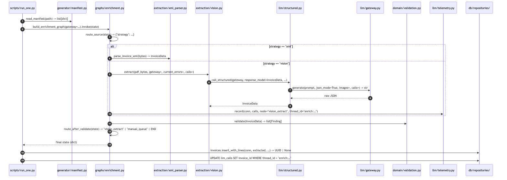

# Bản đồ hàm — kết nối giữa các file ở mức function

**Ngày viết**: 2026-07-30 · **Bổ sung cho**: [`Architecture.md`](Architecture.md) + [`Workflow.md`](Workflow.md)
**Trạng thái nền**: M0–M3 đã đóng · phạm vi: **mã đang có trong repo**, không phải thiết kế

> `Architecture.md` cho bạn **danh từ** — module nào là gì.
> `Workflow.md` cho bạn **động từ** — bước nào chạy khi nào.
> Tài liệu này cho bạn **đường dây**: hàm nào gọi hàm nào, **vào cái gì**, **ra cái gì**.
>
> Mỗi chữ ký hàm ở đây được chép từ mã nguồn, không diễn giải. Nếu một chữ ký trong tài liệu
> khác với `src/`, hãy tin `src/` và sửa tài liệu này.

---

## Quy ước đọc

**Chữ ký** viết theo dạng `file::hàm(tham số) -> kiểu trả về`, đường dẫn tính từ gốc repo:

```
scripts/run_one.py::run_one(invoice_id, *, corpus, gateway) -> dict
    └→ graphs/enrichment.py::build_enrichment_graph(*, gateway, checkpointer) -> CompiledGraph
```

Thụt lề + `└→` nghĩa là **cấp gọi sâu hơn một bậc**. `src/invoice_agent/` được lược bỏ khỏi
đường dẫn cho gọn — mọi đường dẫn không bắt đầu bằng `scripts/`, `tests/` hay `migrations/`
đều nằm dưới `src/invoice_agent/`.

**Nhãn trạng thái** giống `Workflow.md`:

| Nhãn | Nghĩa |
|---|---|
| ✅ | Có mã, có caller production, có test |
| 🟡 | Có mã + test, **chưa có caller production** — xem [§8](#8--hàm-đã-có-nhưng-chưa-ai-gọi) |
| 🔲 M*n* | Chưa có file; milestone sở hữu nó |

---

## Mục lục

| § | Nội dung |
|---|---|
| [0](#0--sáu-workflow-có-mã-chạy-được-hôm-nay) | Sáu workflow có mã chạy được hôm nay |
| [1](#1--wf-1--enrichment-một-hóa-đơn) | **WF-1 Enrichment** — chuỗi gọi đầy đủ, 10 mục con |
| [2](#2--wf-2--sinh-corpus-tổng-hợp) | WF-2 Sinh corpus tổng hợp |
| [3](#3--wf-3--seed-reference-data) | WF-3 Seed reference data |
| [4](#4--wf-4--migration) | WF-4 Migration |
| [5](#5--wf-5--sinh-lại-sơ-đồ-graph) | WF-5 Sinh lại sơ đồ graph |
| [6](#6--wf-6--hitl-durability-spike) | WF-6 HITL durability (spike) |
| [7](#7--trục-ngang-config--dsn--engine) | Trục ngang: config → DSN → engine |
| [8](#8--hàm-đã-có-nhưng-chưa-ai-gọi) | **Hàm đã có nhưng chưa ai gọi** |
| [9](#9--bảng-tra-ngược-file--hàm--ai-gọi) | Bảng tra ngược: file → hàm → ai gọi |

---

# 0 — Sáu workflow có mã chạy được hôm nay

| # | Workflow | Điểm vào | Lệnh | Trạng thái |
|---|---|---|---|---|
| **WF-1** | Enrichment một hóa đơn | `scripts/run_one.py::main` | `python -m scripts.run_one --invoice INV-0001` | ✅ |
| **WF-2** | Sinh corpus tổng hợp | `scripts/generate_invoices.py::main` | `make generate` | ✅ |
| **WF-3** | Seed reference data | `scripts/seed_reference.py::main` | `make seed` | ✅ |
| **WF-4** | Migration | `migrations/env.py` | `make migrate` | ✅ |
| **WF-5** | Sinh lại sơ đồ graph | `scripts/render_graph.py::main` | `python -m scripts.render_graph` | ✅ |
| **WF-6** | HITL durability | `tests/helpers/hitl_child.py::main` | qua `tests/test_hitl_survives_restart.py` | ✅ spike, M5 thay |
| — | `batch_graph` | *chưa có file* | — | 🔲 M4 |
| — | `approval_graph` | *chưa có file* | — | 🔲 M5 |

**Chỉ WF-1 là workflow nghiệp vụ.** Năm cái còn lại là hạ tầng quanh nó: WF-2 sinh đầu vào,
WF-3 + WF-4 dựng database, WF-5 giữ sơ đồ khỏi trôi lệch, WF-6 chứng minh một tính chất mà
M5 sẽ dựa vào.

---

# 1 — WF-1: Enrichment một hóa đơn

## 1.1 Toàn cảnh chuỗi gọi


*File nguồn Mermaid: [`diagrams/fn_enrichment_call_chain.mmd`](diagrams/fn_enrichment_call_chain.mmd)*

Sơ đồ **cấu trúc** graph (sinh từ graph đã compile, có test chống trôi lệch):
[`diagrams/enrichment_graph.mmd`](diagrams/enrichment_graph.mmd).

## 1.2 Điểm vào — `scripts/run_one.py`

```
scripts/run_one.py::main() -> None
    ├→ argparse: --invoice (bắt buộc), --corpus (mặc định Path("corpus"))
    └→ scripts/run_one.py::run_one(invoice_id: str, *, corpus: Path, gateway: LLMGateway|None) -> dict[str, Any]
```

`run_one` làm đúng bốn việc, theo thứ tự:

| # | Gọi ra | Vào | Ra |
|---|---|---|---|
| 1 | `scripts/generator/manifest.py::read_manifest(path: Path)` | `corpus/manifest.jsonl` | `list[dict]` → index theo `invoice_id`; không thấy id thì `SystemExit` |
| 2 | `graphs/enrichment.py::build_enrichment_graph(gateway=gateway)` | `LLMGateway \| None` | graph đã compile (`checkpointer=None`) |
| 3 | `.invoke(state)` | `EnrichmentState` dựng ở bước 2.5 | state cuối, dạng `dict` |
| 4 | `db/repositories/invoices.py::insert_with_lines(...)` + một `UPDATE` thẳng | `final["extracted"]` | `UUID \| None` |

**State khởi tạo** — đây là chỗ duy nhất trong repo dựng `EnrichmentState` từ đầu:

| Field | Lấy từ | Ghi chú |
|---|---|---|
| `invoice_id` | tham số CLI | **Là id manifest (`"INV-0042"`), KHÔNG phải UUID của DB** |
| `source_path` | `corpus / basename(entry["path"])` | manifest ghi đường dẫn tương đối gốc repo, chỉ lấy tên file |
| `pdf_path` | `corpus / basename(entry["pdf_path"])` hoặc `None` | Đích leo thang; chỉ 3 mục trong corpus có |
| `source_type` | `"xml" if entry["source_type"] == "xml" else "pdf"` | manifest ghi `xml` \| `pdf_vision` |
| `strategy` | `"xml"` | Giá trị mồi; `route_source` ghi đè ngay |
| còn lại | rỗng / `0` / `"received"` | |

**Backfill chi phí** (bước 4, sau khi có `db_invoice_id`):

```sql
UPDATE app.llm_calls
   SET invoice_id = :db_invoice_id
 WHERE thread_id = 'enrich:INV-0042'
   AND invoice_id IS NULL
```

Vì sao cần: `vision_extract` tiêu token **trước khi** hàng `invoices` tồn tại, nên nó ghi
`invoice_id = NULL` + `thread_id`. `thread_id` là khóa nối duy nhất giữa hai lần ghi.

## 1.3 `EnrichmentState` — hợp đồng dữ liệu giữa các node

Mọi node nhận **toàn bộ** state và trả về một **dict một phần** (delta). Cách LangGraph trộn
delta vào state phụ thuộc reducer, và đây là nguồn của phần lớn lỗi tinh vi trong graph này:

| Field | Kiểu | Reducer | Node nào ghi |
|---|---|---|---|
| `invoice_id` | `str` | thay thế | *(chỉ state khởi tạo)* |
| `source_path` | `str` | thay thế | *(chỉ state khởi tạo)* |
| `pdf_path` | `str \| None` | thay thế | *(chỉ state khởi tạo)* |
| `source_type` | `"xml" \| "pdf"` | thay thế | *(chỉ state khởi tạo)* |
| `strategy` | `"xml" \| "vision" \| "manual"` | thay thế | `route_source`, `vision_extract` |
| `extracted` | `InvoiceData \| None` | thay thế | `parse_xml`, `vision_extract` |
| `extraction_attempts` | `int` | thay thế | `vision_extract` |
| `current_errors` | `list[str]` | **thay thế** | `parse_xml`, `vision_extract`, `validate` |
| `error_history` | `list[str]` | **`operator.add`** | `parse_xml`, `vision_extract`, `validate` |
| `findings` | `list[Finding]` | **thay thế** | `validate` |
| `llm_calls` | `list[LLMCallRecord]` | **`operator.add`** | `vision_extract` |
| `status` | `str` | thay thế | `manual_queue` |

> **Đảo ngược hai cột reducer là hỏng ngay.** `findings` mà cộng dồn thì một lần retry thành
> công vẫn định tuyến như thất bại — findings của lần trước còn nằm trong list. Ngược lại,
> node trả về **cả list** thay vì delta cho `error_history` / `llm_calls` sẽ khiến mỗi vòng
> nhân đôi dữ liệu.

## 1.4 Năm node — đọc gì, trả gì, gọi ra file nào

| Node | Hàm | Đọc từ state | Trả về (delta) | Gọi ra ngoài file |
|---|---|---|---|---|
| `route_source` | `route_source(state) -> dict` | `source_type` | `strategy` | — (một phép so sánh) |
| `parse_xml` | `parse_xml_node(state) -> dict` | `source_path` | `extracted`, `current_errors`, (`error_history` khi lỗi) | `xml_parser.parse_invoice_xml` |
| `vision_extract` | `vision_extract_node(state, *, gateway) -> dict` | `pdf_path` \| `source_path`, `current_errors`, `extraction_attempts` | `strategy`, `extracted`, `extraction_attempts`, `current_errors`, `error_history`, `llm_calls` | `vision.extract`, `_persist_cost` |
| `validate` | `validate_node(state) -> dict` | `extracted` | `findings`, `current_errors`, `error_history` — hoặc **`{}`** khi `extracted is None` | `validation.validate` |
| `manual_queue` | `manual_queue_node(state) -> dict` | — | `status = "manual_queue"` | — |

`vision_extract` được gắn vào graph qua `functools.partial(vision_extract_node, gateway=gw)`,
nên `gateway` là **tham số tiêm**, không phải biến module. Đó là lý do test thay được gateway
mà không phải monkeypatch.

Một hàm phụ trong cùng file, chỉ dùng nội bộ:

```
graphs/enrichment.py::_describe(finding: Finding) -> str
    # Finding(code="ARITHMETIC_MISMATCH", detail={"goods_subtotal": "…"})
    # -> "ARITHMETIC_MISMATCH: goods_subtotal=…, total_amount=…"
```

Chuỗi này đi vào **hai** chỗ: `current_errors` (mà router đọc) và prompt retry của vision
(qua `sanitize.wrap`). Vì thế nó phải là một dòng máy đọc được, không phải văn xuôi.

## 1.5 Router — hàm quyết định duy nhất

```
graphs/enrichment.py::route_after_validate(state: EnrichmentState) -> str
    # trả về một trong: "vision_extract" | "manual_queue" | END
```

| Điều kiện (xét theo thứ tự) | Trả về |
|---|---|
| `extracted is None` và `strategy == "xml"` và có `pdf_path` | `"vision_extract"` — leo thang XML → vision |
| `extracted is None` và `strategy == "vision"` và `attempts < 3` | `"vision_extract"` — thử lại |
| `extracted is None`, hết đường | `"manual_queue"` |
| có `extracted`, **không** findings | `END` |
| có `extracted`, có findings, `strategy == "xml"` | `END` — **lỗi DỮ LIỆU, mang cờ đi tiếp** |
| có `extracted`, có findings, `strategy == "vision"`, `attempts < 3` | `"vision_extract"` — có thể là lỗi ĐỌC |
| có `extracted`, có findings, vision hết lượt | `"manual_queue"` |

Hằng số `MAX_VISION_ATTEMPTS = 3` nằm cùng file. Chia XML/vision là **theo strategy**, không
theo mã finding — vì `parse_invoice_xml` là hàm thuần còn vision thì không.

## 1.6 Nhánh XML — chuỗi gọi đầy đủ

```
extraction/xml_parser.py::parse_invoice_xml(raw: bytes) -> InvoiceData
    │   # raise XmlExtractionError và KHÔNG BAO GIỜ raise gì khác
    ├→ xml_parser.py::_read(raw: bytes) -> Element
    │       └→ defusedxml.ElementTree.fromstring  # DefusedXmlException / ParseError -> XmlExtractionError
    ├→ xml_schema.py::locate_hdon(root: Element) -> Element          # HDon trần hoặc TDiep/DLieu/HDon
    ├→ xml_parser.py::_require_node(hdon, "DLHDon/TTChung") -> Element
    ├→ xml_parser.py::_require_node(hdon, "DLHDon/NDHDon/TToan") -> Element
    ├→ xml_parser.py::_line(element: Element, index: int) -> InvoiceLine     # cho mỗi HHDVu
    │       ├→ xml_schema.py::integer(raw: str|None, *, where: str) -> int | None
    │       ├→ xml_schema.py::money(raw: str|None, *, where: str) -> Decimal | None
    │       ├→ xml_schema.py::vat_rate(raw: str|None, *, where: str) -> Decimal | None   # '8%' -> 0.08
    │       └→ xml_schema.py::ext_bag(scope: Element|None) -> dict[str, str]  # TTKhac -> {TTruong: DLieu}
    ├→ xml_parser.py::_party(node: Element|None, field: str) -> str | None
    ├→ xml_parser.py::_grand_total(totals: Element) -> Decimal        # TgTTTBSo, bắt buộc
    ├→ xml_schema.py::required_text(node: Element, path: str) -> str
    ├→ xml_schema.py::issue_date(raw: str|None, *, where: str) -> date
    └→ extraction/models.py::InvoiceData(...)                          # pydantic, extra="forbid"
```

**Vào**: `bytes` thô của file XML. **Ra**: `InvoiceData` — hoặc `XmlExtractionError`.

Ranh giới đáng nhớ: parser **không bao giờ phán xét dữ liệu đúng hay sai**. Nó chỉ nói *đọc
được* hay *không đọc được*. Mọi thứ nó raise, theo cấu trúc, đều là lỗi TRÍCH XUẤT — và đó là
điều làm cho việc chia nhánh ở [§1.5](#15--router--hàm-quyết-định-duy-nhất) quyết định được.

## 1.7 Nhánh Vision — chuỗi gọi đầy đủ

### 1.7.1 Từ node xuống gateway

```
graphs/enrichment.py::vision_extract_node(state, *, gateway) -> dict
    │
    ├→ extraction/vision.py::extract(pdf_bytes: bytes, *, gateway, current_errors, calls) -> InvoiceData
    │       ├→ vision.py::rasterize(pdf_bytes: bytes) -> list[bytes]     # pypdfium2, 150 DPI, PNG mỗi trang
    │       │       # PdfiumError -> VisionExtractionError
    │       ├→ (dựng prompt tiếng Việt; nếu có current_errors thì nối vào cuối)
    │       └→ llm/structured.py::call_structured(
    │                  gateway, *, response_model=InvoiceData, prompt, system_prompt,
    │                  model=list(get_settings().vision_model_chain), images=pages,
    │                  max_attempts=3, calls) -> InvoiceData
    │
    └→ graphs/enrichment.py::_persist_cost(calls, *, invoice_id) -> None    # xem §1.9
```

Hai lối vào `extract`, phân biệt bằng một dòng: `source = state.get("pdf_path") or state["source_path"]`
— `pdf_path` khi leo thang từ XML, `source_path` khi hóa đơn vốn chỉ có PDF.

`vision_extract_node` bắt **hai** loại lỗi và biến chúng thành `current_errors`, không cho
thoát ra khỏi graph:

| Exception | Ném từ | Ý nghĩa |
|---|---|---|
| `vision.VisionExtractionError` | `rasterize` | PDF không mở được — chưa từng chạm model |
| `structured.StructuredOutputError` | `call_structured` | 3 lần model đều trả JSON sai schema |

### 1.7.2 Vòng lặp schema — `llm/structured.py`

```
llm/structured.py::call_structured[ModelT](gateway, *, response_model, prompt, system_prompt,
                                           model, images, max_attempts=3, calls) -> ModelT
    │   for _ in range(max_attempts):
    ├→ llm/gateway.py::LLMGateway.generate(current_prompt, system_prompt=, model=,
    │                                      json_mode=True, images=, calls=) -> str
    ├→ response_model.model_validate(json.loads(raw))         # thành công -> return ngay
    └→ structured.py::_retry_prompt(original: str, error: Exception) -> str    # khi hỏng
            └→ extraction/sanitize.py::wrap(text: str) -> str
                    └→ sanitize.py::escape(text: str) -> str    # & trước, rồi < >
    # hết lượt -> raise StructuredOutputError(kèm errors của cả 3 lần)
```

> ⚠️ `sanitize.wrap` ở đây **không phải trang trí**. `str(ValidationError)` của Pydantic trích
> nguyên văn output của model, và một model đọc hóa đơn có payload injection có thể echo payload
> đó vào field. Chuỗi lỗi vì thế quay lại prompt qua một block `<invoice_data>` đã escape.

Chỉ **nửa schema** được retry ở tầng này. Nửa transport (429, fallback model) thuộc gateway —
retry ở cả hai tầng sẽ khiến số `attempt` trong `llm_calls` mất ý nghĩa.

### 1.7.3 Bên trong gateway — `llm/gateway.py`

```
LLMGateway.generate(prompt, system_prompt, model, temperature=0.1, max_tokens=2048,
                    json_mode=False, reasoning_effort=None, calls=None, images=None) -> str
    └→ LLMGateway._generate_impl(...) -> tuple[str, str]        # (text, model đã trả lời)
        ├→ _resolve_chain(model: str|list[str]|None) -> list[str]
        │       └→ _usable_models(models) -> list[str]     # bỏ qua ở mode replay
        │               └→ _keys_for(model: str) -> list[str]
        │                       └→ _provider(model: str) -> str      # tách theo tiền tố "/"
        │
        │   for attempt_model in models_to_try:
        │       ├→ _is_thinking_model(model) -> bool
        │       ├→ _normalize_reasoning_effort(model, effort) -> str
        │       for api_key in api_keys:
        ├→ _complete(*, model, messages, temperature, max_tokens, json_mode,
        │            reasoning_effort, api_key, model_kwargs, images) -> tuple[str, int, int]
        │       ├→ llm/cache.py::make_key(*, model, messages, temperature, max_tokens,
        │       │                         json_mode, reasoning_effort, image_digests) -> str
        │       ├── mode == "replay":
        │       │       └→ llm/cache.py::load(cache_dir, key) -> CachedResponse | None
        │       │               # None -> raise LLMReplayMiss ; .error -> raise RuntimeError
        │       └── mode == "live" | "record":
        │               ├→ litellm.completion(...)          # ← chỗ DUY NHẤT chạm mạng
        │               ├→ _clean_thinking(text: str|None) -> str     # bỏ <think>…</think>
        │               └→ llm/cache.py::save(cache_dir, key, *, model, messages, response) -> Path
        │                       # mode == "record", kể cả khi lỗi (fixture ghi lại cả thất bại)
        │
        ├→ _record_attempt(calls, model, *, started, attempt, messages,
        │                  prompt_tokens=None, completion_tokens=None, error=None) -> None
        │       └→ _count_tokens(model, messages) -> int       # litellm.token_counter, offline
        │       # append MỘT LLMCallRecord cho MỖI LẦN THỬ, kể cả lần hỏng
        │
        └→ raise LLMReplayMiss (nếu có miss) | RuntimeError("All models failed…")
```

**Ba mode, một seam.** `_complete` là điểm duy nhất một request thành lời gọi mạng — hoặc
không. Seam đặt **bên trong** vòng lặp model chứ không bọc quanh `generate()`, vì không có API
key thì chain resolve về rỗng và mọi thứ đặt phía trên sẽ nằm trên nhánh CI không bao giờ tới.

**Ba loại "hỏng", ba cách xử lý khác nhau:**

| Loại | Nhận ra bằng | Hành động |
|---|---|---|
| Rate limit / quota | `_is_rate_limit(err) -> bool` | `continue` — **xoay key**, cùng model |
| Lỗi khác | mọi `Exception` còn lại | `break` — **sang model tiếp theo** |
| Thiếu fixture | `cache.LLMReplayMiss` | `break`, **không ghi record** (không token nào bị đốt) |

Hai hàm public khác của gateway hiện **chưa ai gọi**: `generate_with_model` (móc cho Auditor
M4.1) và `generate_stream` (không có replay, cố tình raise dưới `LLM_MODE=replay`).

## 1.8 Nhánh validate — chuỗi gọi đầy đủ

```
domain/validation.py::validate(invoice: InvoiceData) -> list[Finding]
    │   # KHÔNG BAO GIỜ raise. Mọi thứ trả về là lỗi DỮ LIỆU, không phải lỗi đọc.
    ├→ validation.py::_goods_lines(lines) -> list[InvoiceLine]        # loại TChat == 4
    ├→ domain/money.py::goods_subtotal(lines: Sequence[InvoiceLine]) -> Decimal
    │       └→ money.py::line_amount(line: InvoiceLine) -> Decimal
    │               # ThTien, hoặc fallback ext['Amount'] (VNPT), note line = 0
    ├→ validation.py::_check_lines(goods) -> list[Finding]
    ├→ validation.py::_check_words(invoice) -> list[Finding]
    │       └→ money.py::parse_amount_words(text: str|None) -> Decimal | None
    │               # 'Ba  triệu năm trăm ngàn đồng./.' -> Decimal('3500000'); không đọc được -> None
    ├→ validation.py::_check_tax_codes(invoice) -> list[Finding]
    │       └→ domain/taxcode.py::check_tax_code(mst: str|None, *, required=False) -> Finding | None
    │               ├→ taxcode.py::normalise(mst) -> str | None
    │               └→ taxcode.py::is_valid_checksum(mst10: str) -> bool
    └→ domain/findings.py::make(code: str, **detail) -> Finding        # mọi Finding đi qua đây
```

**Vào**: một `InvoiceData`. **Ra**: `list[Finding]` — rỗng nghĩa là sạch.

Bảy loại finding mà đường dây này sinh ra hôm nay, cùng ngưỡng:

| Mã | Điều kiện | Hằng số |
|---|---|---|
| `ARITHMETIC_MISMATCH` | `goods_subtotal + vat_total != total_amount` | so sánh **chính xác**, không dung sai |
| `SUBTOTAL_MISMATCH` | `invoice.subtotal` có giá trị **khác 0** và lệch | — |
| `VAT_TOTAL_MISMATCH` | **mọi** dòng hàng đều khai `TThue` và tổng lệch | — |
| `LINE_AMOUNT_MISMATCH` | `\|qty × price − amount\| > tol` | `LINE_AMOUNT_TOLERANCE = 0.01` |
| `LINE_VAT_MISMATCH` | `\|amount × rate − vat\| > tol` | `LINE_VAT_TOLERANCE = 0.50` |
| `WORDS_DIGITS_MISMATCH` | đọc được chữ **và** khác số | không đọc được ≠ finding |
| `ITEM_KIND_MISSING` | có dòng `TChat` vắng | — |
| `TAX_CODE_*` (3 mã) | qua `taxcode.check_tax_code` | MST 12 số: chấp nhận vô điều kiện |

`findings.make` đọc `CODE_REGISTRY: dict[str, tuple[severity, raised_by]]`, nên `severity` và
`raised_by` **không thể** lệch với mã. Vocabulary trong `domain/findings.py` được nhân đôi từ
`db/models.py` **có chủ đích** — `domain/` không được import `db/` — và
`tests/test_domain_findings.py` khẳng định hai bản bằng nhau.

## 1.9 Ghi chi phí — chuỗi gọi đầy đủ

```
graphs/enrichment.py::_persist_cost(calls: list[LLMCallRecord], *, invoice_id: str) -> None
    │   # if not calls: return  — không mở transaction vô ích
    ├→ db/engine.py::get_engine() -> Engine          # role invoice_app, .begin() = transaction riêng
    └→ llm/telemetry.py::record(conn, records, *, node, invoice_id=None, batch_id=None,
                                thread_id=None, agent=None, trace_id=None) -> list[int]
            ├→ llm/cost.py::actual_cost_usd(record: LLMCallRecord) -> Decimal     # ACTUAL_PRICES
            ├→ llm/cost.py::shadow_cost_usd(record: LLMCallRecord) -> Decimal     # SHADOW_PRICE
            │       └→ cost.py::_price(rates, record) -> Decimal
            └→ db/repositories/llm_calls.py::record_call(conn, *, model, provider, node,
                       prompt_tokens, completion_tokens, cost_usd, shadow_cost_usd,
                       latency_ms, attempt, succeeded, error, invoice_id, batch_id,
                       thread_id, agent, trace_id) -> int
```

Node truyền `node="vision_extract"` và `thread_id=f"enrich:{invoice_id}"`, **để trống
`invoice_id`**. Đó là chỗ [§1.2](#12--điểm-vào--scriptsrun_onepy) backfill vào.

`telemetry.py` tồn tại như một module riêng để hướng phụ thuộc đi **xuống**: nó import cả
`llm/cost` lẫn `db/repositories`, trong khi gateway chỉ biết dataclass thuần và `db/` không
biết gì về `llm/`.

Hai cột tiền, và khác biệt giữa chúng chính là điểm:

| Cột | Hàm | Nghĩa |
|---|---|---|
| `cost_usd` | `actual_cost_usd` | Thực trả — `$0` với mọi model free tier trong chain |
| `shadow_cost_usd` | `shadow_cost_usd` | Cùng số token, tính theo giá `gpt-4o-mini` — luôn cùng một bảng giá, nên so sánh được xuyên 6 model |

## 1.10 Ghi database — chuỗi gọi đầy đủ

```
scripts/run_one.py::run_one  (trong `with get_engine().begin() as conn:`)
    └→ db/repositories/invoices.py::insert_with_lines(conn, data: InvoiceData, *,
               batch_id=None, source_type="xml", source_path=None, raw_xml=None) -> UUID | None
            ├→ raise MissingSellerTaxCode  nếu không có data.seller_tax_code
            ├→ db/repositories/vendors.py::ensure_vendor(conn, tax_code, name=None) -> None
            │       # INSERT … ON CONFLICT (tax_code) DO UPDATE SET last_seen_at = now()
            │       # KHÔNG BAO GIỜ ghi đè thống kê đã tích lũy
            ├→ invoices.py::insert_row(conn, values: dict) -> UUID | None
            │       # ON CONFLICT ON CONSTRAINT uq_invoices_natural_key DO NOTHING … RETURNING id
            │       # trùng -> trả None, KHÔNG raise
            └→ conn.execute(models.invoice_line_items.insert(), [...])   # bulk, line_no fallback theo vị trí
```

**Ba tính chất của đường dây này**, tất cả đều là lựa chọn thiết kế chứ không phải tình cờ:

1. **Upload lại cùng một file là idempotent, không phải lỗi.** `insert_row` trả `None` khi
   trùng khóa tự nhiên `(seller_tax_code, template_no, invoice_series, invoice_number)`.
2. **Không có MST người bán thì không có danh tính.** `MissingSellerTaxCode` là `ValueError`,
   và design chỉ định `manual_queue` cho ca này — nhưng **`run_one` hiện chưa bắt nó**, nên
   ngoại lệ thoát ra CLI. Đây là một khoảng trống có thật ở M3, M4 đóng.
3. **Graph chỉ có MỘT mặt tiếp xúc database**: bảng `llm_calls`, qua `_persist_cost`. Việc ghi
   `invoices` nằm ở **script**, không nằm trong node — nên `enrichment_graph` chạy được mà
   không cần database, và test tận dụng đúng điều đó.

## 1.11 Ba chỗ WF-1 chạm ra thế giới bên ngoài

| # | Ở đâu | Chạm gì | Transaction |
|---|---|---|---|
| 1 | `vision_extract` node | `litellm.completion` hoặc file fixture | — |
| 2 | `_persist_cost` (trong node) | `app.llm_calls` INSERT | **riêng**, `get_engine().begin()` |
| 3 | `run_one` sau `.invoke()` | `app.vendors`, `app.invoices`, `app.invoice_line_items`, `app.llm_calls` UPDATE | **riêng**, `get_engine().begin()` |

Hai transaction tách nhau **có chủ đích**: chi phí phải được ghi ngay khi token bị tiêu, không
chờ tới cuối run. Run chết giữa chừng thì mọi lời gọi đã bị tính tiền vẫn còn dấu vết.

---

# 2 — WF-2: Sinh corpus tổng hợp

**Lệnh**: `make generate` → `python -m scripts.generate_invoices --count 300 --seed 42 --out corpus`

```
scripts/generate_invoices.py::main() -> None
    └→ generate(*, count: int, seed: int, out: Path) -> None
        │   rng = Random(seed)      # MỘT rng duy nhất xuyên suốt; không random module-level,
        │                           # không datetime.now(), không uuid4()
        ├→ generator/vendors.py::build_vendors(rng: Random, count: int) -> list[Vendor]
        │       # 40 vendor: 30 "đã có lịch sử" + 10 dành cho defect new_vendor
        │
        ├→ generate_invoices.py::_make_base_spec(index, vendor, rng) -> InvoiceSpec
        │
        ├── ① ca vượt ngân sách
        │   ├→ generator/defects.py::build_budget_overrun_case(base, rng) -> list[InvoiceSpec]
        │   └→ scripts/seed_reference.py::BUDGETS       # ← PHỤ THUỘC DUY NHẤT ĐƯỢC PHÉP
        │           # đối chiếu tổng ca với hạn mức đã seed; không vượt -> SystemExit
        │
        ├── ② prompt injection + đối chứng
        │   ├→ defects.py::seed_injection(base, payload) -> InvoiceSpec
        │   └→ defects.py::strip_injection(base) -> InvoiceSpec     # twin, chỉ khác đúng payload
        │
        ├── ③ áp hạn ngạch defect còn lại, theo DEFECT_RATIOS
        │   ├→ defects.py::seed_arithmetic_error(base) -> InvoiceSpec
        │   ├→ defects.py::seed_words_mismatch(base) -> InvoiceSpec
        │   │       └→ generator/amounts.py::to_amount_words(amount, thousand="nghìn") -> str
        │   ├→ defects.py::seed_bad_tax_code(base) -> InvoiceSpec
        │   │       └→ generator/vendors.py::invalidate_checksum(mst: str) -> str
        │   ├→ defects.py::seed_wrong_vat_rate(base) -> InvoiceSpec
        │   ├→ defects.py::duplicate_of(base) -> InvoiceSpec
        │   ├→ defects.py::near_duplicate_of(base, rng) -> InvoiceSpec
        │   └→ generate_invoices.py::_inherited_body_defects(source_defects, source_meta,
        │                                                    target_defects) -> list[str]
        │           └→ generator/manifest.py::BODY_DEFECTS        # defect nào "đi theo thân hóa đơn"
        │
        ├── ④ ghi file
        │   ├→ generator/templates.py::render(spec: InvoiceSpec) -> str
        │   │       ├→ jinja hdon.xml.j2  (+ tdiep.xml.j2 khi spec.root == "tdiep")
        │   │       └→ amounts.py::to_amount_words   (qua property InvoiceSpec.words)
        │   ├→ generator/pdf.py::render_pdf(spec) -> bytes
        │   ├→ generator/pdf.py::render_truncated(spec) -> bytes   ┐
        │   ├→ generator/pdf.py::render_blank() -> bytes           ├ nhóm unreadable_pdf, chia theo i % 3
        │   └→ generator/pdf.py::render_degraded(spec) -> bytes    ┘
        │
        └── ⑤ ghi ground truth
            ├→ generator/manifest.py::DEFECT_CODES     # defect -> mã finding kỳ vọng
            └→ generator/manifest.py::write_manifest(path: Path, records: list[ManifestRecord]) -> None
```

**Vào**: `count`, `seed`, `out`. **Ra**: `out/INV-*.xml`, `out/INV-*.pdf`, `out/manifest.jsonl`.

**Hai trường ground truth khác nhau, dễ nhầm:**

| Trường | Trả lời câu hỏi | Được phép lớn lên? |
|---|---|---|
| `defects` | *Đã CỐ Ý gieo gì vào hóa đơn này?* | ❌ — mang tỉ lệ §10.2, gộp thêm là làm sai tỉ lệ |
| `expected_finding_codes` | *Một detector ĐÚNG phải bắt được gì?* | ✅ — gồm cả defect thừa kế từ hóa đơn bị nhân bản |

**Điểm nối ngược duy nhất giữa WF-2 và WF-3**: `generate_invoices.py` import
`scripts.seed_reference.BUDGETS`. Nếu ai đó nâng hạn mức MKT, ba hóa đơn Marketing lặng lẽ
thôi vượt ngân sách và nhóm `budget_overrun` thành 12 hóa đơn không vi phạm gì — hỏng âm thầm,
chỉ lộ ra ở số recall của M6. Nên `generate` **từ chối chạy** thay vì sinh ra corpus đó.

`corpus/manifest.jsonl` sau đó là **đầu vào của WF-1** ([§1.2](#12--điểm-vào--scriptsrun_onepy)):
đó là toàn bộ mối nối giữa hai workflow.

---

# 3 — WF-3: Seed reference data

**Lệnh**: `make seed` → `python -m scripts.seed_reference`

```
scripts/seed_reference.py::main() -> None
    ├→ db/engine.py::get_owner_engine() -> Engine        # role chủ sở hữu, KHÔNG phải invoice_app
    └→ seed_reference.py::seed(conn: Connection) -> None          # idempotent, mọi write là upsert
        ├→ db/repositories/reference.py::upsert_department(conn, code, name_vi) -> None
        ├→ db/repositories/reference.py::upsert_category(conn, code, name_vi, debit_account,
        │                                     vat_account, credit_account, keywords_vi) -> None
        └→ db/repositories/reference.py::upsert_budget(conn, department_code, period, category,
                                              amount_limit, warn_threshold_pct=0.8) -> int
```

Ba hằng dữ liệu nằm ngay trong file, và **là nguồn sự thật**:

| Hằng | Nội dung | Ai đọc |
|---|---|---|
| `DEPARTMENTS` | 5 phòng ban | `seed` |
| `CATEGORIES` | 7 danh mục + tài khoản TT133 + `keywords_vi` | `seed`; `keywords_vi` là **baseline không-LLM** của M6 |
| `BUDGETS` | 5 hạn mức tháng 2026-07 | `seed` **và** `scripts/generate_invoices.py` |

Vì sao `get_owner_engine` chứ không `get_engine`: seed là việc quản trị. Runtime chạy bằng role
`invoice_app` bị REVOKE bớt quyền; nếu seed cũng dùng role đó thì các REVOKE trở thành trang trí.

---

# 4 — WF-4: Migration

**Lệnh**: `make migrate` → `alembic upgrade head`

```
migrations/env.py  (module level)
    ├→ config.py::get_settings() -> Settings
    ├→ Settings.alembic_sqlalchemy_url -> str          # KHÔNG phải app_sqlalchemy_url
    │       # .replace("%", "%%")  cho ConfigParser của Alembic
    ├→ db/models.py::metadata                          # target_metadata
    └→ env.py::include_object(object, name, type_, reflected, compare_to) -> bool
            # trả False cho mọi thứ thuộc schema `langgraph`
```

**Ba lý do `alembic_sqlalchemy_url` là một property riêng**, không dùng chung với runtime:

1. Scheme phải là `postgresql+psycopg://` — `postgresql://` trần nghĩa là psycopg2 (không cài).
2. `%` trong query param phải escape thành `%%`.
3. `search_path` **không được để `app` đứng trước**. Với `-csearch_path=app,public`, Alembic
   coi `app` là schema mặc định của connection và phản chiếu bảng dưới khóa `None`, trong khi
   `db/models.py` khai dưới `'app'` — đo 2026-07-28: **32 diff ma** (16 remove_fk + 16 add_fk)
   trên một database khớp hoàn toàn với migration.

`include_object` là thứ chặn `alembic revision --autogenerate` sinh `DROP TABLE` cho
`checkpoints` / `checkpoint_blobs` / `checkpoint_writes` — tức chặn một migration vô tình xóa
sạch mọi HITL đang chờ duyệt. `tests/test_alembic_ignores_langgraph.py` chạy autogenerate
**thật** để giữ tính chất này.

---

# 5 — WF-5: Sinh lại sơ đồ graph

```
scripts/render_graph.py::main() -> None
    ├→ graphs/enrichment.py::build_enrichment_graph() -> CompiledGraph
    ├→ .get_graph().draw_mermaid() -> str        # renderer DUY NHẤT chạy offline
    └→ ghi docs/diagrams/enrichment_graph.mmd
```

**Vào**: không có. **Ra**: một file `.mmd` được commit.

Đây là workflow duy nhất mà **đầu ra là tài liệu**. `tests/test_enrichment_graph.py` sinh lại
rồi so sánh, nên sơ đồ không thể âm thầm ngừng mô tả đúng graph.

---

# 6 — WF-6: HITL durability (spike)

**Không phải mã production** — `tests/helpers/spike_graph.py` là đồ chơi, M5 sẽ xóa khi
`graphs/approval.py` thật ra đời. Nhưng nó là workflow **duy nhất** trong repo hôm nay chạy qua
checkpointer, nên đường dây của nó đáng đọc.

```
tests/test_hitl_survives_restart.py
    └→ subprocess: python -m tests.helpers.hitl_child <thread_id>
        └→ tests/helpers/hitl_child.py::main(thread_id: str) -> None
            ├→ checkpointer.py::build_checkpointer(settings=None) -> Iterator[PostgresSaver]
            │       ├→ config.py::get_settings().checkpointer_dsn      # search_path=langgraph,public
            │       ├→ PostgresSaver.from_conn_string(dsn)
            │       └→ serde.py::build_serde() -> JsonPlusSerializer
            │               # allowed_msgpack_modules: Finding, InvoiceData, InvoiceLine, LLMCallRecord
            ├→ saver.setup()
            ├→ tests/helpers/spike_graph.py::build_spike_graph() -> StateGraph
            │       ├→ n1_record(state) -> dict        # side effect TRƯỚC cổng
            │       ├→ n2_gate(state) -> dict          # CHỨA interrupt()
            │       └→ n3_finish(state) -> dict
            └→ .compile(checkpointer=saver).invoke(state, config={"configurable": {"thread_id": …}})
    # tiến trình cha SIGKILL, rồi resume từ checkpoint trong Postgres
```

**Số đo là toàn bộ lý do spike tồn tại** (2026-07-27, LangGraph 1.2.9), sau `kill -9` + resume:

| Node | Vị trí so với `interrupt()` | Số row ghi được |
|---|---|---|
| `n1_record` | TRƯỚC cổng | **1** |
| `n2_gate` | CHỨA cổng | **2** |

Nghĩa là: *node chứa `interrupt()` chạy lại TỪ ĐẦU khi resume*. Hệ quả bắt buộc cho M5 —
`post_entry` phải là node **riêng, SAU** `approval_gate`.

`serde.build_serde()` là mắt xích dễ bỏ sót: không đăng ký kiểu, một `Finding` quay về từ
checkpoint dưới dạng `dict` — im lặng, và hỏng ở xa chỗ gây ra. `tests/test_serde.py` liệt kê
từ một state đã điền đủ, nên thiếu sót fail ở CI chứ không fail trong một checkpoint.

---

# 7 — Trục ngang: config → DSN → engine

Mọi workflow đều đi qua đây. Đây là **nơi duy nhất đọc environment**.

```
config.py::get_settings() -> Settings        # @lru_cache — get_settings.cache_clear() để reset trong test
    │
    ├→ Settings._with_options(options: str, base: str|None = None) -> str
    │       # quote(options, safe="") — BẮT BUỘC: giá trị chứa '=' và psycopg coi
    │       # dấu '=' thứ hai trong một query param là lỗi cú pháp
    │
    ├→ .app_dsn                    -csearch_path=app,public
    ├→ .checkpointer_dsn           -csearch_path=langgraph,public
    ├→ .runtime_dsn                -csearch_path=app,public       (base = runtime_database_url)
    ├→ .app_sqlalchemy_url         app_dsn      + postgresql+psycopg://
    ├→ .runtime_sqlalchemy_url     runtime_dsn  + postgresql+psycopg://
    └→ .alembic_sqlalchemy_url     -csearch_path=public           (base = database_url)
```

**Ai dùng property nào:**

| Người dùng | Property | Role | Vì sao |
|---|---|---|---|
| `db/engine.py::get_engine` | `runtime_sqlalchemy_url` | `invoice_app` | Đặc quyền tối thiểu; không UPDATE/DELETE trên `audit_log` |
| `db/engine.py::get_owner_engine` | `app_sqlalchemy_url` | chủ sở hữu | Seed script — việc quản trị |
| `migrations/env.py` | `alembic_sqlalchemy_url` | chủ sở hữu | `app` **không** đứng đầu search_path — xem [§4](#4--wf-4--migration) |
| `checkpointer.py::build_checkpointer` | `checkpointer_dsn` | chủ sở hữu | `setup()` tạo bảng, phải rơi vào schema `langgraph` |
| `tests/helpers/spike_graph.py` | `app_dsn` | chủ sở hữu | Mô phỏng write action của M5 |

**Ai đọc field nào của `Settings`:**

| Field | Người đọc |
|---|---|
| `llm_model_chain`, `groq_api_keys`, `gemini_api_keys`, `openrouter_api_keys`, `openai_api_key` | `LLMGateway.__init__` |
| `vision_model_chain` | `extraction/vision.py::extract` — chain **riêng**, vì cả 2 model groq và cả 2 model openrouter đều không hỗ trợ vision |
| `llm_mode`, `llm_cache_dir` | `LLMGateway.__init__` → `_resolve_chain`, `_complete` |
| `max_concurrency` | 🔲 M4 — chưa ai đọc |
| `langfuse_*` | Chỉ để validate + tài liệu hóa; `observability.py` đọc thẳng `os.environ` |

> ⚠️ `_CsvList = Annotated[list[str], NoDecode]` không phải trang trí: pydantic-settings coi
> `list[str]` là "complex type" và chạy `json.loads()` lên giá trị env **trước khi** validator
> `mode="before"` được gọi, nên `LLM_MODEL_CHAIN=groq/a,gemini/b` sẽ raise `SettingsError` chứ
> không bao giờ tới được `_split_csv`.

`db/engine.py` cả hai hàm đều `@lru_cache` — một Engine dùng chung toàn tiến trình.

---

# 8 — Hàm đã có nhưng chưa ai gọi

Đây là phần quan trọng nhất để hiểu hệ thống hôm nay: **một mảng lớn mã đã có, đã test, nhưng
chưa nằm trên bất kỳ đường dây production nào.** Kiểm chứng bằng `grep` toàn bộ `src/` +
`scripts/` ngày 2026-07-30.

## 8.1 Repository chưa có caller

| File | Hàm | Ai sẽ gọi |
|---|---|---|
| `db/repositories/flags.py` | `raise_flag`, `open_flags_for`, `resolve_flag` | 🔲 M4 — node `signals` / `audit` |
| `db/repositories/journal.py` | `create_entry_with_lines`, `get_for_invoice`, `get_lines` | 🔲 M5.3, **và chỉ sau khi có `tools/guards.py`** |
| `db/repositories/approvals.py` | `open_approval`, `record_decision`, `list_pending`, `get_approval` | 🔲 M5 — `approval_graph` |
| `db/repositories/episodic.py` | `record_episode`, `similar_episodes` | 🔲 M4.8 — learn |
| `db/repositories/batches.py` | `create_batch`, `complete_batch`, `get_batch` | 🔲 M4 — `batch_graph` |
| `db/repositories/budget_consumption.py` | `record_consumption` | 🔲 M4.5 |
| `db/audit.py` | `record` | 🔲 M5 — mọi write action |
| `db/repositories/invoices.py` | `set_status`, `get_by_id`, `get_by_natural_key`, `get_lines` | 🔲 M4 — vì thế `invoices.status` hôm nay chỉ từng mang 2 trong 11 giá trị |
| `db/repositories/vendors.py` | `get_vendor`, `update_profile` | 🔲 M4.3 |
| `db/repositories/reference.py` | `list_departments`, `get_category`, `list_budgets` | 🔲 M4 — `classify`, `reconcile_budget` |

> `journal.py` mang một cảnh báo rõ ràng trong docstring: **đừng thêm caller production trước
> M5.3.** `tests/test_schema_constraints.py::test_no_production_caller_of_journal_repository`
> biến câu đó thành một test — gỡ được lớp bảo vệ này đòi hỏi sửa test, tức là một hành động có
> chủ đích.

## 8.2 Domain chưa có caller

| File | Hàm | Ai sẽ gọi |
|---|---|---|
| `domain/accounting.py` | `build_journal_entry(invoice, accounts) -> list[JournalLine]` | 🔲 M4/M5 — node `post_entry` |
| `domain/anomaly.py` | `new_vendor`, `price_outlier`, `near_duplicate` | 🔲 M4 — node `signals` |
| `domain/budget.py` | `consume(limit, warn_pct, invoices) -> list[Consumption]` | 🔲 M4.5 — `reconcile_budget` |

Ba hằng số trong `domain/anomaly.py` (`NEAR_DUP_WINDOW_DAYS`, `PRICE_OUTLIER_Z`,
`PRICE_OUTLIER_MIN_INVOICES`) mang nhãn **PROVISIONAL AND UNMEASURED** — đây là chỗ duy nhất
trong repo mà một hằng số không kèm phép đo, và file nói thẳng điều đó thay vì bịa lý do.

## 8.3 Hạ tầng chưa có caller production

| File | Hàm | Ghi chú |
|---|---|---|
| `llm/gateway.py` | `generate_with_model` | Móc cho Auditor M4.1 — biết model nào đã trả lời để **loại nó** khỏi việc tự chấm bài |
| `llm/gateway.py` | `generate_stream` | Không có định dạng fixture cho streaming, nên dưới `LLM_MODE=replay` nó **cố tình raise** thay vì lặng lẽ gọi mạng thật |
| `checkpointer.py` | `build_checkpointer` | Chỉ WF-6 (spike) và test gọi; `run_one` truyền `checkpointer=None` |
| `observability.py` | `observe` | Chưa decorator nào dùng; hiện là identity no-op vì thiếu key Langfuse |
| `scripts/generator/amounts.py` | `make_line_money` | Chỉ `tests/test_generator_amounts.py` |
| `scripts/generator/defects.py` | `make_note_line`, `make_vnpt_line`, `make_non_vat_spec`, `make_header_only_vat_spec` | Chỉ `tests/test_generator_hard_shapes.py` — bốn hình dạng khó đo được từ 8 fixture thật |

---

# 9 — Bảng tra ngược: file → hàm → ai gọi

Đọc theo chiều ngược lại của tài liệu này: bạn đang mở một file và muốn biết nó nối vào đâu.

## 9.1 `src/invoice_agent/`

| File | Hàm public | Ai gọi nó | Nó gọi ai |
|---|---|---|---|
| `graphs/enrichment.py` | `build_enrichment_graph`, 5 node, `route_after_validate` | `scripts/run_one.py`, `scripts/render_graph.py` | `xml_parser`, `vision`, `validation`, `telemetry`, `db.engine` |
| `extraction/xml_parser.py` | `parse_invoice_xml` | `graphs/enrichment.py` | `xml_schema`, `extraction/models`, `defusedxml` |
| `extraction/xml_schema.py` | `locate_hdon`, `required_text`, `money`, `integer`, `vat_rate`, `issue_date`, `ext_bag` + hằng tag | `xml_parser`, `domain/money`, `domain/validation` | — (thuần) |
| `extraction/models.py` | `InvoiceData`, `InvoiceLine` | khắp nơi — đây là **hợp đồng trung tâm** | pydantic |
| `extraction/vision.py` | `extract`, `rasterize` | `graphs/enrichment.py` | `llm/structured`, `llm/gateway`, `config`, pypdfium2 |
| `extraction/sanitize.py` | `escape`, `wrap` | `llm/structured.py` | — (thuần) |
| `llm/structured.py` | `call_structured` | `extraction/vision.py` | `llm/gateway`, `extraction/sanitize` |
| `llm/gateway.py` | `LLMGateway.generate` (+ 2 hàm 🟡) | `llm/structured.py`, `graphs/enrichment.py` (tiêm) | `llm/cache`, `llm/cost`, `config`, litellm |
| `llm/cache.py` | `make_key`, `load`, `save`, `CachedResponse`, `LLMReplayMiss` | `llm/gateway.py` | — (chỉ filesystem) |
| `llm/cost.py` | `actual_cost_usd`, `shadow_cost_usd`, `LLMCallRecord` | `llm/telemetry.py`, `llm/gateway.py` (dataclass) | — (thuần) |
| `llm/telemetry.py` | `record` | `graphs/enrichment.py::_persist_cost` | `llm/cost`, `db/repositories/llm_calls` |
| `domain/validation.py` | `validate` | `graphs/enrichment.py` | `domain/money`, `domain/taxcode`, `domain/findings`, `xml_schema` |
| `domain/money.py` | `line_amount`, `goods_subtotal`, `parse_amount_words` | `domain/validation`, `domain/accounting` | `xml_schema`, `extraction/models` |
| `domain/taxcode.py` | `normalise`, `is_valid_checksum`, `check_tax_code` | `domain/validation` | `domain/findings` |
| `domain/findings.py` | `Finding`, `make`, `CODE_REGISTRY` | `validation`, `taxcode`, `anomaly`, `budget` | — (thuần) |
| `domain/accounting.py` 🟡 | `build_journal_entry`, `CategoryAccounts`, `JournalLine` | *chưa ai* | `domain/money` |
| `domain/anomaly.py` 🟡 | `new_vendor`, `price_outlier`, `near_duplicate` | *chưa ai* | `domain/findings` |
| `domain/budget.py` 🟡 | `consume` | *chưa ai* | `domain/findings` |
| `db/engine.py` | `get_engine`, `get_owner_engine` | `graphs/enrichment`, `scripts/run_one`, `scripts/seed_reference` | `config` |
| `db/models.py` | 16 `Table` + hằng vocabulary | mọi repository, `migrations/env.py` | SQLAlchemy |
| `db/repositories/invoices.py` | `insert_with_lines`, `insert_row` (+ 4 hàm 🟡) | `scripts/run_one.py` | `db/models`, `db/repositories/vendors` |
| `db/repositories/vendors.py` | `ensure_vendor` (+ 2 hàm 🟡) | `db/repositories/invoices.py` | `db/models` |
| `db/repositories/llm_calls.py` | `record_call` | `llm/telemetry.py` | `db/models` |
| `db/repositories/reference.py` | `upsert_department`, `upsert_category`, `upsert_budget` (+ 3 🟡) | `scripts/seed_reference.py` | `db/models` |
| `config.py` | `get_settings`, `Settings` + 6 property DSN | **tất cả** | pydantic-settings |
| `checkpointer.py` 🟡 | `build_checkpointer` | chỉ test + WF-6 | `config`, `serde`, langgraph |
| `serde.py` | `build_serde`, `ALLOWED_MSGPACK_MODULES` | `checkpointer.py` | langgraph |
| `observability.py` 🟡 | `observe`, `TRACING_ENABLED` | *chưa ai* | `os.environ`, langfuse (có điều kiện) |

## 9.2 `scripts/`

| File | Hàm public | Ai gọi nó | Nó gọi ai |
|---|---|---|---|
| `run_one.py` | `run_one`, `main` | CLI, `tests/test_run_one.py` | `generator/manifest`, `graphs/enrichment`, `db/repositories/invoices`, `db/engine` |
| `generate_invoices.py` | `generate`, `main` | CLI (`make generate`) | `generator/*`, `seed_reference.BUDGETS` |
| `seed_reference.py` | `seed`, `main`, `DEPARTMENTS`/`CATEGORIES`/`BUDGETS` | CLI (`make seed`), `generate_invoices.py` | `db/repositories/reference`, `db/engine` |
| `render_graph.py` | `main` | CLI, `tests/test_enrichment_graph.py` | `graphs/enrichment` |
| `generator/templates.py` | `render`, `InvoiceSpec`, `LineSpec` | `generate_invoices.py`, `generator/defects.py` | `generator/amounts`, jinja2 |
| `generator/defects.py` | 9 hàm gieo defect (`seed_*`, `*_of`, `build_budget_overrun_case`) + 4 hàm 🟡 | `generate_invoices.py` | `generator/templates`, `generator/amounts`, `generator/vendors` |
| `generator/amounts.py` | `to_amount_words` (+ `make_line_money` 🟡) | `generator/templates`, `generator/defects` | — (thuần) |
| `generator/vendors.py` | `build_vendors`, `invalidate_checksum`, `VALID_MSTS` | `generate_invoices.py`, `generator/defects.py` | — (thuần) |
| `generator/pdf.py` | `render_pdf`, `render_truncated`, `render_blank`, `render_degraded` | `generate_invoices.py` | fpdf2 |
| `generator/manifest.py` | `write_manifest`, `read_manifest`, `ManifestRecord`, `DEFECT_CODES`, `BODY_DEFECTS` | `generate_invoices.py` **và** `scripts/run_one.py` | — (chỉ JSON) |

## 9.3 Bốn kiểu dữ liệu đi xuyên nhiều file

Nếu chỉ nhớ được bốn thứ, hãy nhớ bốn kiểu này — chúng là mặt cắt thật giữa các tầng:

| Kiểu | Định nghĩa ở | Sinh ra bởi | Tiêu thụ bởi |
|---|---|---|---|
| `InvoiceData` | `extraction/models.py` | `xml_parser.parse_invoice_xml`, `vision.extract` | `validation.validate`, `accounting.build_journal_entry` 🟡, `invoices.insert_with_lines` |
| `Finding` | `domain/findings.py` | `findings.make` (từ `validation`, `taxcode`, `anomaly` 🟡, `budget` 🟡) | `enrichment._describe`, `route_after_validate`, `flags.raise_flag` 🟡 |
| `LLMCallRecord` | `llm/cost.py` | `gateway._record_attempt` | `cost.actual_cost_usd` / `shadow_cost_usd`, `telemetry.record` |
| `EnrichmentState` | `graphs/enrichment.py` | `scripts/run_one.py` | cả 5 node + router |

Ba kiểu đầu nằm trong `serde.ALLOWED_MSGPACK_MODULES` — cùng với `InvoiceLine` — tức chúng
cũng chính là những gì được phép vượt qua ranh giới checkpoint. `EnrichmentState` không cần
đăng ký vì nó là `TypedDict`, tức đã là `dict` khi serialize.

> Thêm một kiểu mới vào `EnrichmentState` thì **phải** thêm vào `serde.py`.
> `tests/test_serde.py` liệt kê từ một state đã điền đủ, nên bỏ sót sẽ fail ở CI.

---

## Đọc tiếp

| Câu hỏi | Tài liệu |
|---|---|
| Hệ thống được cấu tạo thế nào | [`Architecture.md`](Architecture.md) |
| Cái gì xảy ra, theo thứ tự nào | [`Workflow.md`](Workflow.md) |
| Nên đọc hai tài liệu trên theo lộ trình nào | [`Reading-Guide.md`](Reading-Guide.md) |
| Thiết kế đầy đủ, gồm cả phần chưa làm | [`project-f-system-design.md`](project-f-system-design.md) |
| Milestone nào sở hữu các hàm 🟡 ở §8 | [`Plan_Project_F_2026-07-25.md`](Plan_Project_F_2026-07-25.md) §3 |
